# Folio : Agentic AI for Systematic Literature Reviews

**From a research question to a source-linked scientific manuscript.**

Academic project: **Development of an Agentic AI Pipeline for Conducting Rigorous, Transparent, and Reproducible Systematic Reviews on Any Given Topic.**

Folio is a local research application that helps users search scientific literature, select relevant papers, extract evidence, assess study quality, and write a review manuscript. It combines specialized AI agents, a retrieval-augmented generation pipeline, and a browser interface for reading sources and reviewing decisions.

The system supports two working modes: **Guided**, with human decisions at key stages, and **Automated draft**, which runs the intermediate stages and asks the user to accept or reject the final result.

The main output is a **scientific manuscript about the research topic**. A separate **technical and reproducibility report** explains the search process, model settings, checks, and execution details. Both can be downloaded as Word documents.

> Folio produces an AI-assisted review draft with traceable evidence. Final acceptance of a draft does not certify every claim, a complete literature search, or compliance with all PRISMA requirements.

## Table of contents

1. [Project purpose](#1-project-purpose)
2. [Features and scope](#2-features-and-scope)
3. [System architecture and UML design](#3-system-architecture-and-uml-design)
4. [Agents and responsibilities](#4-agents-and-responsibilities)
5. [Review workflow](#5-review-workflow)
6. [Models and retrieval](#6-models-and-retrieval)
7. [Installation with Docker](#7-installation-with-docker)
8. [Configuration](#8-configuration)
9. [User guide](#9-user-guide)
10. [Reports and exported files](#10-reports-and-exported-files)
11. [Evidence checks and PRISMA reporting](#11-evidence-checks-and-prisma-reporting)
12. [Tests, case study and evaluation](#12-tests-case-study-and-evaluation)
13. [Repository structure](#13-repository-structure)
14. [Scope and limitations](#14-scope-and-limitations)
15. [Conclusion](#15-conclusion)
16. [References](#16-references)

## 1. Project purpose

A systematic review follows an explicit process to find, select, assess, and summarize research that answers a question. Folio supports this process through a modular multi-agent architecture.

The project addresses the following objectives:

- Turn a topic into a configurable review protocol.
- Build search strategies and retrieve records from academic sources.
- Apply inclusion and exclusion criteria with recorded reasons.
- Retrieve full texts and extract evidence linked to source passages.
- Support study appraisal and narrative synthesis.
- Generate a scientific manuscript, evidence tables, references, and selection diagrams.
- Keep decisions, intermediate artifacts, and execution traces available for inspection.
- Support both automation and human oversight.

**Example input:** “How is deep learning used to detect pneumonia in chest X-ray images?”

**Example outputs:** a review manuscript with an abstract, methods, findings, discussion, and conclusion; study tables; a PRISMA-style flow diagram; bibliographic references; and a separate technical report.

The architecture accepts different research topics. Users must adapt search terms, eligibility criteria, extraction fields, and appraisal domains to their subject.

**Individual project scope.** This submission documents system integration, local model configuration, Docker deployment, review-workflow improvements, source-verification controls, interface refinement, software testing and technical documentation. The XAI/IDS case study records the evaluation of the resulting system. External libraries and scientific sources remain identified separately; human-reference assessment and the final demonstration are reported according to their actual completion status.

## 2. Features and scope

| Area | What Folio provides |
| --- | --- |
| Review setup | Research question, rationale, criteria, sources, publication years, record limits, extraction fields, and synthesis plan |
| Academic discovery | OpenAlex, PubMed, and arXiv connectors with search logs and deduplication |
| Screening | Two blinded prompt roles for title/abstract screening, followed by full-text eligibility assessment |
| Evidence extraction | Source quotations, PDF page references, structured evidence, and numerical table extraction |
| RAG | Dense and lexical retrieval, rank fusion, optional LLM reranking, and extractive context compression |
| Study appraisal | Configurable domains, source-supported machine proposals, and explicit human assessments in Guided mode |
| Scientific writing | Evidence-based introduction, results, discussion, conclusion, and abstract; methods derived from review records |
| Quality checks | Citation and number checks, semantic support audits, and manuscript criticism |
| Reporting | Markdown, DOCX, BibTeX, CSV evidence tables, PRISMA flow data, and SVG/PNG diagrams |
| User experience | Chat workspace, original PDF reader, step-by-step decisions, progress, pause/resume, and downloads |
| Auditability | Saved checkpoints, model configuration, decision history, artifact versions, and execution traces |

## 3. System architecture and UML design

The design is documented through four complementary views: logical components, deployment nodes, implemented classes, and the execution sequence. Components describe responsibilities; deployment nodes describe where software runs; classes describe data structures and services in the code.

### 3.1 Logical component architecture

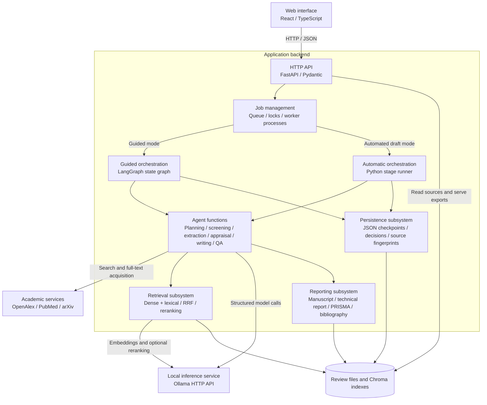

*Figure 1. Logical component architecture. Arrows show calls or data access; they do not indicate a separate server for every component.*

| Layer | Technology | Responsibility |
| --- | --- | --- |
| Browser interface | React, TypeScript, Vite | Configure reviews, read papers, record decisions, and display reports |
| HTTP API | FastAPI and Pydantic | Validate requests, expose review data, and serve artifacts |
| Job execution | Background worker and subprocesses | Run one workflow job at a time, preserve logs, and handle safe pauses |
| Guided orchestration | LangGraph | Manage stage transitions, saved state, and human review gates |
| Automatic orchestration | Python workflow runner | Execute the shared stages without intermediate human approvals |
| Model integration | LangChain components and LangChain Ollama | Structured model calls and local inference |
| Knowledge retrieval | Chroma and custom retrieval modules | Index passages and retrieve evidence for each paper |
| Document processing | PyMuPDF | Read PDFs, locate passages, render pages, and extract tables |
| Reporting | Python exporters and Word document generation | Produce Markdown, DOCX, BibTeX, CSV, and diagrams |

An agent is a specialized role with its own instructions, inputs, output schema, and checks. Agents share the configured LLM. Their implementation uses Python functions and structured schemas rather than an inheritance tree of autonomous agent objects.

### 3.2 Deployment diagram

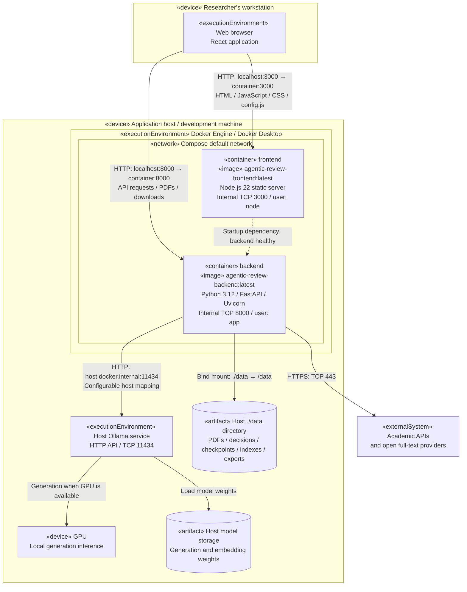

*Figure 2. Deployment view using UML node stereotypes. In the default local deployment, the browser and application host run on the same computer. Their boxes separate user interaction from server execution. Ports are published on host loopback by default.*

Deployment constraints:

- **Two application containers:** the frontend serves compiled assets; the backend executes the workflows and serves research files.
- **Direct browser-to-API communication:** the frontend server does not proxy review requests to FastAPI. `API_BASE_URL` must resolve from the browser; CORS controls permitted origins.
- **Host inference:** Ollama runs outside Compose. Its weights are not included in either application image. With the default embedding setting, embedding inference uses CPU and generation can use the GPU.
- **Embedded vector storage:** Chroma runs inside the backend process with indexes on the data mount; there is no separate Chroma container.
- **Persistent research data:** recreating containers preserves the host `data/` directory. The image filesystem is not the research database.
- **Platform-specific routing:** on the supported WSL setup, `host.docker.internal` maps to the private WSL address. Other installations use the configured Docker-to-host route.

The image names shown correspond to the Compose project name `agentic-review`. Compose derives names from the project name unless explicitly overridden. Inspect the names on another installation with `docker compose images`.

### 3.3 Class diagram: protocol, decisions, and appraisal

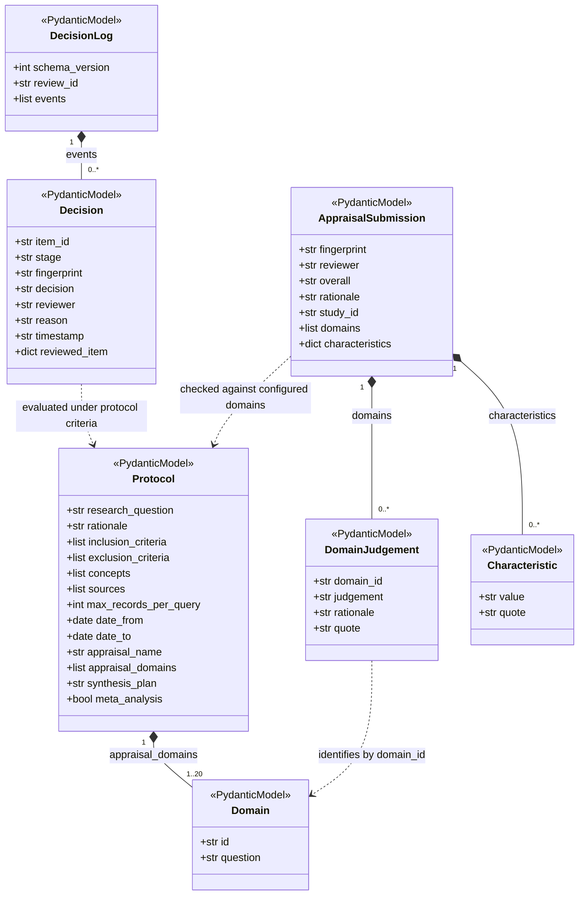

*Figure 3. Implemented protocol and human-review models. Selected fields are shown; the diagram is not an exhaustive schema dump.*

**Notation:** `*--` denotes a contained value; `..>` denotes a dependency. Quoted cardinalities state how many nested values are allowed. Dependencies on the protocol are resolved by validation functions; they are not object-pointer fields inside `Decision` or `AppraisalSubmission`.

The diagram follows the code:

| Model | Source | Design rule |
| --- | --- | --- |
| `Protocol`, `Domain` | [methodology/protocol.py](methodology/protocol.py) | Require meaningful criteria, a valid date range, and distinct appraisal domain identifiers |
| `Decision`, `DecisionLog` | [storage/human_review.py](storage/human_review.py) | Keep reviewer identity, the reviewed content, and the content fingerprint with each event |
| `AppraisalSubmission`, `DomainJudgement`, `Characteristic` | [methodology/appraisal.py](methodology/appraisal.py) | Store human judgements and source support separately from machine proposals |

`date_from` and `date_to` are optional. Decision and judgement strings have restricted values in the Pydantic schemas. The submission schema permits an empty domain list, while saving a real appraisal checks the submitted domains against the approved protocol.

### 3.4 Class diagram: execution and scientific writing

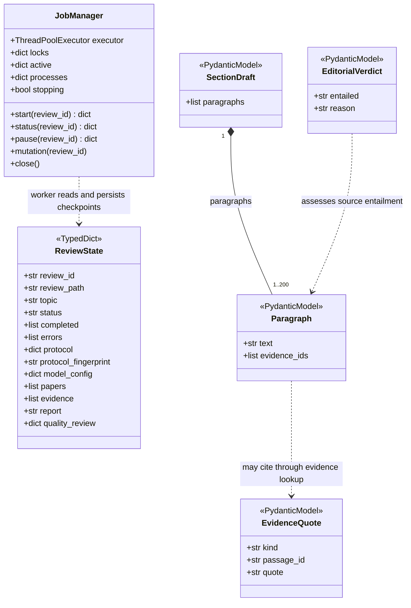

*Figure 4. Execution service and writing schemas. `ReviewState` is a typed dictionary, not an ORM entity or a Pydantic object. The two groups describe execution and writing, not a single object ownership tree.*

`JobManager` launches a subprocess for a review and controls queued/running jobs. The workflow reads and writes `ReviewState` checkpoints in JSON. `SectionDraft` and `Paragraph` constrain model output; `EditorialVerdict` records a support audit. Paragraph evidence IDs resolve through a fact lookup that can reference source quotations, table rows, or permitted study assessments. They are not direct `EvidenceQuote` object references.

Sources: [api/jobs.py](api/jobs.py), [workflow/state.py](workflow/state.py), [agents/writing_agent.py](agents/writing_agent.py), and [agents/grounding.py](agents/grounding.py).

The Guided graph uses `ReviewState`; the automatic runner persists a dictionary with additional mode-specific fields. Both runners use saved state to reuse completed work.

### 3.5 Sequence diagram: a Guided systematic review

This diagram presents the review process through its research participants and specialized agent roles. It follows a Guided review from the research question to the final manuscript, including the researcher's decisions.

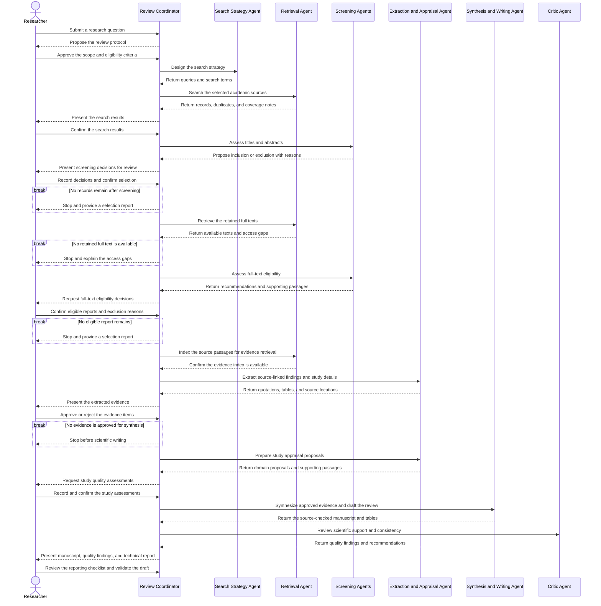

*Figure 5. Functional sequence for a Guided systematic review. Participants represent the research roles defined in the project. Messages describe their responsibilities and deliverables. A `break` fragment ends the process when there is no usable selection or approved evidence.*

| Participant | Responsibility |
| --- | --- |
| Researcher | Defines the question, reviews evidence, and records the required scientific decisions |
| Review Coordinator | Organizes the stages, preserves progress, and requests human validation |
| Search Strategy Agent | Prepares source-specific queries from the review protocol |
| Retrieval Agent | Searches scientific sources, handles full-text acquisition, and builds the evidence index |
| Screening Agents | Assess titles, abstracts, and full texts against the eligibility criteria |
| Extraction and Appraisal Agent | Extracts traceable study evidence and prepares source-supported quality proposals |
| Synthesis and Writing Agent | Organizes approved findings and produces the scientific manuscript |
| Critic Agent | Checks the manuscript for support, consistency, omissions, and overgeneralization |

The participant names follow the agent roles in the project specification. Some roles are implemented by several cooperating modules, as documented in Section 4. The separate class diagrams show the implementation structures; this sequence focuses on the research workflow and its human decisions.

The workflow is a predefined sequence with conditional review gates. It does not freely invent a new execution plan for every question. API validation errors leave the current phase unchanged. Model or source failures are logged. Completed checkpoints and usable partial results are retained for resume; unfinished operations may be retried.

## 4. Agents and responsibilities

Some roles are implemented as LLM agents; others combine deterministic tools and workflow functions.

| Role | Main input | Responsibility and output | Implementation |
| --- | --- | --- | --- |
| Coordinator | Review state and configuration | Schedules stages, saves progress, resumes work, and routes human decisions | [Guided graph](workflow/graph.py), [automatic runner](workflow/automatic.py), [job manager](api/jobs.py) |
| Planner | Research topic | Proposes a question, rationale, eligibility criteria, concept groups, and an appraisal profile | [planner_agent.py](agents/planner_agent.py) |
| Search strategy | Protocol concepts and synonyms | Builds source-specific queries, including Boolean expressions and optional MeSH terms | [protocol.py](methodology/protocol.py); [search_agent.py](agents/search_agent.py) also provides a query-generation helper |
| Retrieval | Search strategies and source settings | Calls academic APIs, records provenance, deduplicates records, and prepares index construction | [search.py](tools/search.py), [ingest.py](rag/ingest.py) |
| Title/abstract screeners | Title, abstract, and protocol criteria | Produce two blinded screening proposals with reasons and criterion references | [screening_agent.py](agents/screening_agent.py) |
| Full-text screener | Full text and eligibility criteria | Checks criteria against source passages and audits ambiguous or conflicting decisions | [full_text_agent.py](agents/full_text_agent.py), [eligibility_audit.py](agents/eligibility_audit.py) |
| Extraction | Relevant passages and source tables | Selects quotations, proposes structured fields, and retains numerical results with source locations | [extraction_agent.py](agents/extraction_agent.py), [tables.py](rag/tables.py) |
| Appraisal | Study text, evidence, and configured domains | Proposes domain judgements with source support; disagreements and missing support remain unclear | [appraisal_agent.py](agents/appraisal_agent.py), [appraisal.py](methodology/appraisal.py) |
| Synthesis | Eligible evidence and study information | Builds source-linked evidence summaries and comparative narrative proposals | [synthesis_agent.py](agents/synthesis_agent.py), [narrative_agent.py](agents/narrative_agent.py) |
| Scientific writer | Eligible source-linked facts | Drafts the scientific sections and checks each paragraph before inclusion | [writing_agent.py](agents/writing_agent.py) |
| Critic / quality assurance | Manuscript, evidence, and protocol | Checks consistency and support; identifies located contradictions, omissions, and overgeneralizations | [critic_agent.py](agents/critic_agent.py), [scientific_qa.py](agents/scientific_qa.py) |
| Conversational assistant | User question and available review context | Explains the workflow and answers questions; chat messages do not approve research decisions | [chat_agent.py](agents/chat_agent.py) |

The two screening roles use the same local model with different prompts. Their agreement measures **simulated inter-agent consistency**, not agreement between independent human reviewers.

## 5. Review workflow


*Figure 6. Review activity flow. Guided mode inserts explicit human decisions and phase confirmations between the processing stages.*

| Step | What happens | What the user can inspect |
| --- | --- | --- |
| 1. Define scope | A protocol records the question, criteria, sources, dates, and planned methods | Protocol and revisions |
| 2. Search | Queries are sent to the selected academic sources | Queries, dates, results, limits, and source errors |
| 3. Deduplicate | Records are compared using identifiers and normalized bibliographic information | Retained records and duplicates |
| 4. Screen abstracts | Two prompt roles assess eligibility | Decisions, reasons, disagreements, and missing information |
| 5. Acquire full texts | The system attempts to obtain available papers | Original PDFs and acquisition outcomes |
| 6. Assess eligibility | Full-text passages are compared with protocol criteria | Include, exclude, or uncertain proposals and supporting passages |
| 7. Index and extract | Relevant passages and source table rows are retrieved and checked | Evidence tables, quotations, numerical values, and pages |
| 8. Appraise studies | Study quality is assessed under the configured rubric | Domain proposals and human assessments where recorded |
| 9. Write | Eligible evidence supports the scientific narrative | Five generated section checks and the manuscript |
| 10. Check and export | Quality checks and reporting artifacts are produced | Manuscript, technical report, references, diagrams, and audit files |

An unavailable PDF is an **access gap**, not a scientific exclusion. A missing extraction is a processing gap. An uncertain eligibility decision means that the available evidence does not support a clear decision under the criteria.

If the search is empty, all records are excluded, no retained full text is available, or no eligible evidence remains, processing stops with a **search and selection outcome**. The system exports `selection_report.md` and `selection_report.docx` with recorded counts and recovery options. It does not continue through empty appraisal and scientific writing stages. Existing decisions are preserved; revising a protocol or changing a decision remains an explicit researcher action.

### Guided and automatic modes

| Behaviour | Guided | Automated draft |
| --- | --- | --- |
| Protocol | User edits and explicitly approves | Planner creates a machine proposal |
| Intermediate phases | Pause for phase confirmations and required item decisions | Run without intermediate human validation |
| Eligibility and evidence | Human decisions control inclusion and approved evidence | Machine proposals remain labelled as machine proposals |
| Appraisal | User records study/domain assessments | System records source-supported domain proposals |
| Final action | Review the manuscript and confirm completion | Accept or reject the overall draft |
| Meaning of acceptance | A recorded user decision within the workflow | Acceptance of the draft, not individual certification of all claims |

In Guided mode, **Confirm & continue** does not replace the required decisions for individual items. In automatic mode, the system never creates fictitious human protocol approvals, evidence approvals, or study appraisals.

## 6. Models and retrieval

### Default local models

| Component | Default | Purpose |
| --- | --- | --- |
| Generation LLM | `qwen3.5:4b` | Planning, screening, extraction proposals, appraisal, writing, and model-based checks |
| Embedding model | `qwen3-embedding:0.6b` | Converts passages and queries into vectors for semantic retrieval |
| Context budget | `8192` tokens | Shared context setting for generation calls |
| Embedding GPU setting | `EMBEDDING_NUM_GPU=0` | Runs embedding inference on CPU to leave GPU memory for generation |
| Temperature | `0` in new-review defaults | Reduces variation in structured research tasks; it does not guarantee correctness |
| Thinking | Off in the default review setup | Keeps ordinary calls bounded; disputed eligibility has a separate audit-reasoning setting |

The local development setup used an NVIDIA RTX 4060 Laptop GPU with 8 GB VRAM. This is a deployment example, not a universal hardware requirement or speed guarantee. Actual memory and latency depend on model quantization, context length, available RAM, and the number of passages processed.

Folio uses the models selected in configuration. It does not download models automatically or silently switch to a larger model. A model change must remain traceable. Changing the embedding model creates a separate index identity rather than mixing incompatible vectors.

### Why Qwen was selected

Model selection considered source fidelity, structured decisions, generation speed, and the memory available on the development GPU. The final configuration uses **Qwen3.5 4B for generation** and **Qwen3-embedding 0.6B for retrieval**. These choices have different evidence behind them: a measured local diagnostic for the LLM, and a capability/integration comparison for embeddings.

#### LLM comparison: Qwen3.5 4B and Gemma3 4B

Both models were run on the same 12 synthetic source-based cases with an 8,192-token context, temperature 0, and thinking disabled where supported. The cases check negation, missing information, attribution to cited work, numerical values, and dataset/metric associations. A case passes only when the verdict matches the expected answer and any required quotation matches the supplied source.

| Criterion | Qwen3.5 4B | Gemma3 4B |
| --- | --- | --- |
| Ollama identifier | `qwen3.5:4b` | `gemma3:4b` |
| Tested quantization | Q4_K_M | Q4_K_M |
| Strict source-based cases passed | **7 / 12** | 4 / 12 |
| Median generation throughput | **53.38 tokens/s** | 49.53 tokens/s |
| Observed GPU residency during the diagnostic | Entire loaded model on GPU | Entire loaded model on GPU |
| Project decision | **Selected as the default generation model** | Evaluated and not retained in the active installation |

Qwen produced more correct, source-supported answers and a higher median generation rate in this diagnostic, so it offered the better measured trade-off for this setup. The 4B configuration also leaves more memory headroom than a larger model when running the review pipeline on an 8 GB GPU.

These are **model-selection diagnostics**, not the accuracy of the complete review system. The sample is small, the results are from one recorded run, and both models made errors. The human-reference evaluation in Section 12 measures scientific performance separately. Throughput measures generated tokens, not the total time to search, read, and write a review.

The results were captured on 10 November 2026. A portable summary with model digests, case outcomes, and measurement scope is available in [model_selection_results.json](evaluation/model_selection_results.json). The diagnostic procedure is implemented in [scripts/audit_models.py](scripts/audit_models.py).

To repeat the diagnostic with both models installed and Ollama reachable from the host:

```bash
python3 scripts/audit_models.py \
  --base-url http://127.0.0.1:11434 \
  --models qwen3.5:4b gemma3:4b \
  --output data/model_audits/repeated-diagnostic.json
```

Set `--base-url` to the actual host Ollama address on WSL. The command measures the installed model revisions; results can change after a model or runtime update.

#### Embedding options: Qwen3-embedding and Nomic

The development model inventory included both embedding options below. Qwen is the model integrated into the retained review indexes. This table compares the recorded local model metadata and the integration choice; it does not present an unmeasured retrieval benchmark.

| Criterion | Qwen3-embedding 0.6B | Nomic Embed Text |
| --- | --- | --- |
| Ollama identifier | `qwen3-embedding:0.6b` | `nomic-embed-text:latest` |
| Recorded model size | About 639 MB | About 274 MB |
| Recorded embedding dimensions | 1,024 | 768 |
| Recorded supported context | 32,768 tokens | 2,048 tokens |
| Query preparation in the project | Scientific retrieval instruction followed by the query | `search_query:` prefix, with `search_document:` for documents |
| Labelled head-to-head retrieval score | Not measured | Not measured |
| Project decision | **Selected and used for the retained Chroma indexes** | Earlier available alternative; not retained in the active installation |

Qwen was retained for its supported input length, the project's scientific-query instruction, and compatibility with the current indexes. Embedding inference runs on CPU to reserve GPU memory for the LLM. More dimensions or a longer supported context do not, by themselves, establish better retrieval accuracy. The project's text chunks are smaller than a full paper; the model context figure is a capability, not the size of every submitted passage.

For a measured relevance comparison, [evaluation/retrieval.py](evaluation/retrieval.py) evaluates human-labelled source quotations using recall@k, reciprocal rank, and latency, as explained in Section 12.

### How hybrid RAG works

RAG means retrieving relevant source text before asking the model to reason or write.

1. Extract text from downloaded papers and divide it into passages.
2. Store passage embeddings and metadata in Chroma.
3. Retrieve semantically similar passages through dense vector search.
4. Retrieve passages through a BM25-like lexical scoring method.
5. Combine the rankings with reciprocal rank fusion.
6. Optionally ask the local LLM to rerank the candidates.
7. Keep a bounded, source-exact text window as context.
8. Match selected quotations to the source and retain PDF page locations when available.

Academic discovery finds **papers**. RAG finds **passages inside the acquired papers**. Passage retrieval does not prove that the bibliographic search found every relevant study.

## 7. Installation with Docker

### Requirements

- Git.
- Docker Engine with Compose, or Docker Desktop with the WSL integration enabled when using WSL.
- A running Ollama installation with the two configured local models.
- Internet access for installation, academic APIs, and PDF downloads.
- Enough disk space for container images, model weights, PDFs, and vector indexes.

Python and Node do not need to be installed on the host for the Docker application. Ollama runs separately on the host in this Compose setup.

### Step 1 : Clone the repository

```bash
git clone https://github.com/Loubnaelghazi/Agentic-AI-Pipeline-for-Systematic-Reviews-on-Any-Given-Topic-End-to-End-Project.git agentic-review
cd agentic-review
```

### Step 2 : Create the configuration

On a fresh clone:

```bash
cp .env.example .env
```

For an existing installation, keep the current `.env` and compare it with [.env.example](.env.example). Do not commit `.env` or API keys.

### Step 3 : Prepare Ollama

Install and start [Ollama](https://docs.ollama.com/quickstart), then download the default models:

```bash
ollama pull qwen3.5:4b
ollama pull qwen3-embedding:0.6b
ollama list
```

Ollama must accept connections from the backend container. `127.0.0.1` inside a container refers to that container, not the host. Configure the reachable address through `DOCKER_OLLAMA_BASE_URL`; the default is `http://host.docker.internal:11434`.

If the host service only listens on an unreachable loopback interface, configure its bind address for your Docker network and restart Ollama. Use the [Ollama server configuration guide](https://docs.ollama.com/faq) and keep access limited to the intended local environment.

### Step 4 — Build and start

```bash
docker compose up -d --build --wait
docker compose ps
```

Open:

| Service | Address |
| --- | --- |
| Application | [http://localhost:3000](http://localhost:3000) |
| API documentation | [http://localhost:8000/docs](http://localhost:8000/docs) |
| API health | [http://localhost:8000/api/health](http://localhost:8000/api/health) |
| Model readiness | [http://localhost:8000/api/runtime](http://localhost:8000/api/runtime) |

A healthy API means the HTTP service is running. Check `/api/runtime` as well to confirm that Ollama and the configured models are available.

### Docker images and services

| Service | Build definition | Runtime | Port | Persistent data |
| --- | --- | --- | --- | --- |
| Backend | [Dockerfile](Dockerfile) | Python 3.12, FastAPI, one Uvicorn worker | `8000` | Host `./data` mounted at `/data` |
| Frontend | [frontend/Dockerfile](frontend/Dockerfile) | Node 22 serving compiled React assets | `3000` | Review data is stored by the backend |

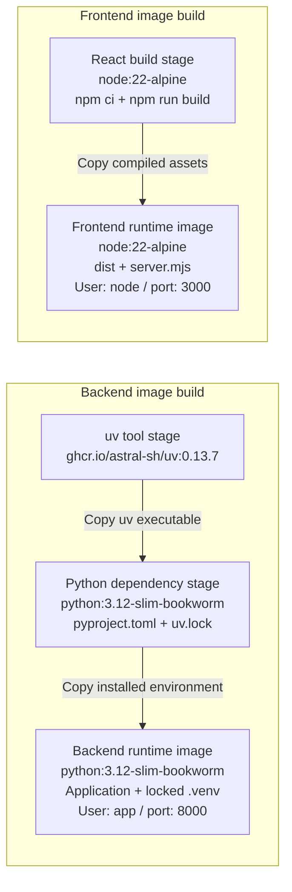

*Figure 7. Multi-stage image construction. Build tools and runtime artifacts are separated. Review data and Ollama model weights are managed outside these images.*

Both images use multi-stage builds and non-root runtime users. Python dependencies are installed from `uv.lock`; frontend dependencies use `package-lock.json`. Compose builds the application images locally; this setup does not require a pre-published project image from Docker Hub.

Ollama is **not a third Compose service**. Model weights are managed by the host Ollama installation and are not bundled inside the application images. GPU inference happens through that host service; the Python container does not require its own CUDA model installation.

The frontend serves static assets and runtime configuration. The browser calls FastAPI directly; there is no Nginx or backend reverse proxy in this stack. Compose publishes the ports on the host loopback interface.

### Stop, restart, and update

```bash
# Stop the application and preserve saved reviews.
docker compose stop

# Start the existing services again.
docker compose up -d --wait

# Rebuild after source changes, when no workflow is running.
docker compose up -d --build --wait

# Inspect logs and images.
docker compose logs --tail=100 backend frontend
docker compose images
```

### WSL startup helper

For the private WSL Ollama service configuration supported by this repository:

```bash
sh scripts/start-local.sh --wait
```

The helper refreshes the configured private WSL address when the corresponding systemd override exists. It also recreates the backend if Docker Desktop restores an empty data bind mount. It does not install Docker, Ollama, models, or the systemd override on a new machine.

For a memory-constrained WSL installation using the bundled `llama-server`, [scripts/ollama-memory.conf.example](scripts/ollama-memory.conf.example) provides an optional Ollama systemd drop-in. It caps the reusable prompt cache at 256 MiB and limits per-slot context checkpoints to two. These are inference caches, separate from the review checkpoints saved by Folio. Verify the `LLAMA_ARG_*` options against the installed engine version before applying the file. This host-service configuration is not activated by Compose or `.env`.

```bash
# Optional host configuration; apply when no review is running.
sudo install -D -m 0644 scripts/ollama-memory.conf.example /etc/systemd/system/ollama.service.d/20-folio-memory.conf
sudo systemctl daemon-reload
sudo systemctl restart ollama
```

Monitor host RAM and swap as well as GPU memory. Exhausted system memory can make inference exceed request timeouts even while model layers are on the GPU. Restarting a failed review alone does not address that resource condition.

## 8. Configuration

[.env.example](.env.example) documents the environment settings. Review-specific settings are selected in the browser and saved with the review.

| Setting | Default / example | Meaning |
| --- | --- | --- |
| `OLLAMA_MODEL` | `qwen3.5:4b` | Default generation model |
| `EMBEDDING_MODEL` | `qwen3-embedding:0.6b` | Passage/query embedding model |
| `OLLAMA_BASE_URL` | `http://127.0.0.1:11434` | Ollama address for local Python execution |
| `DOCKER_OLLAMA_BASE_URL` | `http://host.docker.internal:11434` | Ollama address used by the container |
| `OLLAMA_NUM_CTX` | `8192` | Generation context budget |
| `EMBEDDING_NUM_GPU` | `0` | CPU embedding inference to reserve VRAM |
| `OLLAMA_AUDIT_REASONING` | `true` | Careful reasoning for disputed eligibility, where supported |
| `OLLAMA_REQUEST_TIMEOUT` | `300` seconds | Default inference request timeout |
| `OLLAMA_RETRY_ATTEMPTS` | `2` | Maximum attempts for supported transient failures |
| `RERANK_ENABLED` | `true` | Optional LLM passage reranking |
| `API_BASE_URL` | `http://localhost:8000` | API address that the browser can reach |
| `CORS_ORIGINS` | Local development origins | Browser origins allowed to call the API |
| `DATA_DIR` | Local `data/`; `/data` in Compose | Persistent review storage |
| `LOCAL_UID`, `LOCAL_GID` | `1000` | Backend image user IDs for bind-mount permissions |
| `OPENALEX_API_KEY` | Empty | Metadata API credential, when required by the provider |
| `OLLAMA_HOST_ADDRESS` | Empty | Optional host mapping for private WSL routing |

If your Linux user IDs differ from `1000`, set `LOCAL_UID` and `LOCAL_GID` before building. Use `id -u` and `id -g` to inspect them.

In the browser, Settings provides model choice, run mode, thinking, temperature, record limits, years, and sources. Both year fields blank means no date restriction. One-sided date ranges are supported. OpenAlex and PubMed use publication dates; arXiv uses submission dates.

The record limit applies **per query**, not to the entire review. Small limits are useful for a smoke test but can reduce literature coverage. Start a new review when changing the search configuration after processing has begun.

## 9. User guide

### Start a review

1. Open the application and select a new conversation.
2. Open **Settings** in the prompt box.
3. Choose the model, mode, sources, years, and record limit.
4. Enter a focused research question and submit it.
5. Follow the current action card in the conversation.

For a short functional test, use a narrow question and a small record limit. For a substantive review, define and justify coverage rather than treating the test settings as an exhaustive search.

### Research workspace and setup

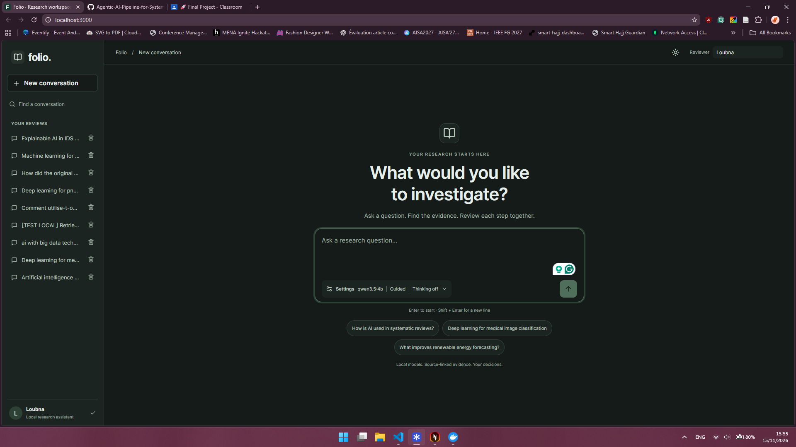

*Figure 8. Starting a new review. The researcher enters a question and opens Settings before submitting it.*

The main text box accepts the research question. Suggested questions illustrate possible topics. The left sidebar lists saved reviews so the researcher can return to earlier work. The controls below the text box show the selected model, execution mode and thinking setting. This screenshot shows **Guided** selected for a new conversation; it is a setup example, not evidence that the automatic XAI/IDS case study ran in Guided mode.

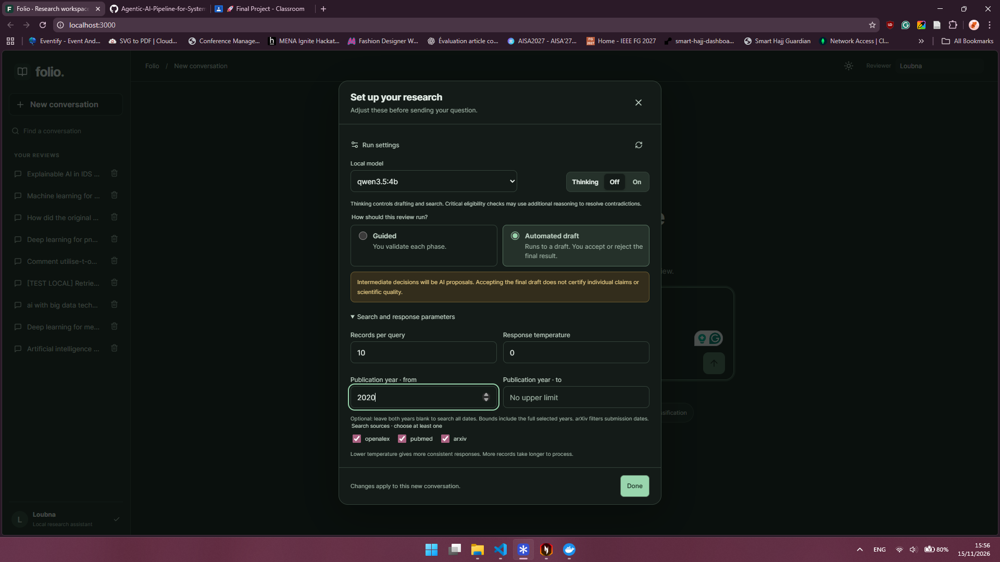

*Figure 9. Configuring a new review. The setup dialog lets the researcher choose how the workflow runs and define its search boundaries.*

| Control | Purpose |
| --- | --- |
| Local model | Select an installed Ollama model for generation |
| Thinking | Control reasoning for ordinary generation; critical eligibility checks can use separate careful audits |
| Guided | Request researcher decisions and confirmations at intermediate stages |
| Automated draft | Process intermediate stages automatically, then request acceptance or rejection of the overall draft |
| Records per query | Limit records returned for each source query; this is not a limit on the whole review |
| Response temperature | Control variation in model responses; lower values favor consistency but do not guarantee correctness |
| Publication years | Set optional lower and upper year bounds; leaving both blank applies no year restriction |
| Search sources | Choose one or more academic connectors: OpenAlex, PubMed and arXiv |

Select **Done**, enter the question and submit it to start. These settings apply to the new conversation. The screenshot illustrates editing the lower year bound to **2020** with no upper bound. The recorded XAI/IDS case study in Section 12 uses **2022–2025**; its saved protocol is the reference for that run. Selecting Automated draft does not create human approvals for individual claims or certify scientific quality.

### Guided mode: step by step

| Phase | User action |
| --- | --- |
| Protocol | Create a template or request a planner suggestion. Read and edit the question, criteria, synonyms, dates, extraction fields, and appraisal rubric. Save and explicitly approve it. |
| Search results | Inspect the retrieved records and source logs. Confirm the phase to start screening. |
| Screening | Resolve the requested decisions using the title, abstract, and criteria. Save each decision, then confirm the phase. |
| Full-text eligibility | Read the original papers and supporting passages. Include or exclude reports against the protocol. Full-text exclusions require a reason. |
| Evidence review | Check quotations, attribution, categories, values, and page references. Approve or reject the evidence items. |
| Study appraisal | Review study characteristics and each appraisal domain. Record your own judgement and supporting source quotation where required. AI proposals do not fill in human approval. |
| Manuscript | Read the scientific draft, quality notes, tables, and references. Review the PRISMA checklist and confirm the final phase. |

Enter your reviewer name when recording decisions. **Save & next** saves an item and advances the queue. **Skip for now** leaves it undecided. Required pending decisions must be finished before confirming the phase.

### Automated draft: step by step

1. Select **Automated draft** before submitting the question.
2. Let the system run planning, search, screening, acquisition, extraction, appraisal, writing, and checks.
3. Read the manuscript and technical report when generation finishes.
4. Inspect the original papers and any uncertain or flagged findings.
5. Choose **Accept final result** or **Reject final result**.

Final acceptance applies to the overall draft. It does not create intermediate human approvals. Reports with unresolved eligibility are kept separate from the evidence supporting primary conclusions.

### Read papers and follow progress

- **Papers & PDFs** opens the paper library.
- **Read original PDF** provides page navigation and zoom while preserving source layout.
- **Browser PDF view** and **Download PDF** provide access to the saved original file.
- The progress card shows the current operation and available per-paper counts.
- **Activity** provides the execution log.
- **Pause to review** requests a pause at a safe boundary; a model call may finish before the pause takes effect.
- **Resume** reuses completed stages and checkpoints, although unfinished operations may run again.

The chat assistant can explain a stage, but writing “approve” in chat does not record a scientific decision. Use the dedicated review buttons.

### Remove an unused conversation

Use the trash button next to a conversation in the sidebar and confirm the action. The conversation disappears from the workspace; its files are preserved under the local `data/deleted_reviews/` directory. Running or queued reviews cannot be removed. Pause a running review and wait for its worker to stop first.

## 10. Reports and exported files

### Scientific manuscript

The manuscript concerns the **research question and included studies**. Its structure includes:

1. Structured abstract.
2. Introduction and review objective.
3. Methods and eligibility criteria.
4. Results, selection flow, study characteristics, and findings.
5. Discussion and interpretation.
6. Study and review limitations.
7. Conclusion.
8. Declarations and references.

Word exports use scientific document styling, native tables, captions, page numbers, and an embedded selection diagram. The writing agent generates five narrative sections; the methods and selection counts are built from the review records.

### Technical and reproducibility report

This separate report describes the model configuration, execution trace, source excerpts, appraisal proposals, search details, quality findings, and operational limitations. It allows a reader to inspect how the manuscript was produced without turning the scientific discussion into a report about the software.

### Artifact reference

Files are stored under `data/reviews/REVIEW_ID/outputs/`. Some are mode-specific or appear only after the relevant stage completes.

| Artifact | Purpose |
| --- | --- |
| `automatic_review.md`, `automatic_review.docx` | Scientific manuscript from Automated draft mode |
| `literature_review.md`, `literature_review.docx` | Scientific manuscript from Guided mode |
| `technical_report.md`, `technical_report.docx` | Separate technical and reproducibility report |
| `references.bib` | BibTeX bibliography |
| `evidence_table.csv`, `evidence.json` | Extracted evidence and supporting source passages |
| `approved_evidence.json` | Human-approved evidence in Guided mode |
| `numerical_results.csv` | Source numerical table results |
| `full_text_decisions.csv` | Automatic report-level eligibility and exclusion details |
| `prisma_flow.json`, `prisma_flow.svg`, `prisma_flow.png` | Selection counts and diagram |
| `prisma_checklist.json` | Reporting checklist and recorded assessments |
| `evidence_map.csv`, `evidence_map.svg` | Evidence maps produced by Guided reporting |
| `search_strategy.json`, `search_log.json` | Search queries, source responses, dates, and coverage notes |
| `retrieved_records.json`, `duplicates.json` | Retrieval provenance and deduplication records |
| `automatic_appraisal.json`, `appraisal_proposals.json` | Machine appraisal proposals by mode |
| `appraisals.json`, `human_decisions.json` | Recorded human assessments and decisions |
| `scientific_manuscript.json` | Writing checkpoints, paragraph evidence links, accepted and rejected drafts |
| `scientific_quality.json` | Located scientific criticism and completion/failure details |
| `automatic_quality.json`, `quality_review.json` | Mode-specific quality summaries |
| `execution_trace.json`, `runs/` | Stage timings, outcomes, and worker logs |
| `meta_analysis_template.csv` | Guided reporting template for quantitative preparation |

The Word document is the convenient reading copy. The JSON and CSV files provide the detailed audit trail.

## 11. Evidence checks and PRISMA reporting

### Evidence controls

The system combines deterministic checks with model-based audits:

- Compare decisions with explicit criterion identifiers.
- Challenge disputed eligibility and preserve unresolved cases as uncertain.
- Match selected quotations to retrieved passages and original PDF text.
- Retain PDF page references when they can be verified.
- Preserve table headers, units, decimals, and source geometry.
- Check paragraph citations and unsupported numerical values.
- Audit semantic support and attribution before accepting generated prose.
- Retain rejected drafts and failed checks for inspection.
- Locate manuscript criticism in actual manuscript and evidence passages.

These checks reduce identifiable errors. Exact source matching alone does not establish that a quotation is relevant, that its interpretation is correct, or that it describes the current study rather than cited work.

### Appraisal approach

The planner can propose a general, prediction-model, or diagnostic-accuracy rubric. Users can edit the domains in the protocol. Machine proposals use `low`, `high`, or `unclear` judgements with source support; missing support and disagreement remain unclear.

These are **project-defined rubrics**, not full implementations of validated clinical instruments. A formal risk-of-bias assessment requires an appropriate instrument and researcher review. Prediction-model and diagnostic-study guidance are linked in the [references](#16-references).

### PRISMA-oriented reporting

Folio keeps identified records, duplicates, screening exclusions, access failures, full-text exclusions, unresolved eligibility, and retained reports separate. Count checks help detect inconsistent flows.

The checklist provides review items and suggested manuscript locations. Users assess the reporting and record explanations. The diagram is adapted from PRISMA 2020 with attribution in the exported figure. **A diagram or completed export is not an automatic certificate of PRISMA compliance.**

Reports and independent studies are different units. Several reports may describe one study. Confirmed study identifiers are needed before interpreting report counts as independent study counts.

## 12. Tests, case study and evaluation

The evaluation separates **software correctness** from **scientific performance**. Passing a regression test does not measure screening accuracy on real literature.

The academic evaluation addresses completeness, accuracy, inter-agent consistency, and time savings against a manual reference. The tools calculate results from actual annotations; this README does not supply assumed scientific scores.

### Case study: explainable AI for intrusion detection

This case study follows a real review from the research question to the generated manuscript. It tests whether the agents can search, select, read and organize scientific evidence in one saved workflow.

**Status recorded on 15 November 2026:** the automatic workflow has produced the scientific manuscript, a separate technical report, tables, references and the selection diagram. All five generated narrative sections passed the implemented paragraph and citation checks. The exported Word file was inspected to confirm that those sections are actually present. Nine human title/abstract assessments are recorded below. Scientific criticism still has unresolved checks, and the manuscript has not received final researcher acceptance; it is an AI-generated draft for scientific review.

#### Research question and configuration

> Which explainable AI techniques have been applied to intrusion detection systems, how have they been evaluated in laboratory or operational settings, and what evidence and gaps concern their use in Security Operations Centers?

An **intrusion detection system (IDS)** detects suspicious activity in network or host data. **Explainable AI (XAI)** helps people understand model predictions. A **Security Operations Center (SOC)** is the operational setting in which analysts investigate security alerts. The review studies XAI methods for IDS and examines their possible value for SOC analysts.

| Setting | Value used in this case study |
| --- | --- |
| Execution mode | Automated draft, with final researcher review |
| Publication period | 1 January 2022 to 31 December 2025 |
| Academic sources | OpenAlex, PubMed and arXiv |
| Search cap | 10 records per query and source; this is a bounded demonstration |
| Generation model | `qwen3.5:4b`, temperature `0.0` |
| Reasoning | Off for ordinary generation; separate careful eligibility audits enabled |
| Embedding model | `qwen3-embedding:0.6b`, running on the CPU |
| Generation hardware | NVIDIA GeForce RTX 4060 Laptop GPU, 8 GB VRAM |
| Deployment | Docker frontend and backend; Ollama on the host |

#### Inclusion and exclusion criteria

The researcher clarified that laboratory studies should be eligible. A real SOC deployment is therefore **not required**. Detection performance, explanation quality and analyst outcomes are compared when available; each paper does not have to report all three.

| Type | Criterion |
| --- | --- |
| Include | Applies, evaluates or systematically reviews explainable or interpretable AI methods for IDS |
| Include | Reports empirical findings or a systematic synthesis, using laboratory datasets or operational environments |
| Include | Article body written in English |
| Exclude | Evaluated application concerns only tasks other than intrusion detection |
| Exclude | XAI is mentioned only as background or future work, without application, evaluation or systematic analysis for IDS |

An unavailable PDF is recorded as an access failure, not a scientific exclusion. Missing or conflicting evidence leads to an **uncertain** recommendation rather than an invented inclusion or exclusion.

The first search was too restrictive because it required SOC-related terms. After the scope clarification, the protocol was revised and the search was extended using two main concepts:

```text
("explainable AI" OR "XAI" OR "interpretable machine learning" OR "SHAP" OR "LIME")
AND
("intrusion detection" OR "network intrusion detection" OR "IDS")
```

The connectors translate these concepts into source-specific queries. Earlier searches and the additional searches remain in the search log. Existing PDFs were reused, while screening was repeated under the revised protocol. The history preserves the change; the scope clarification did not create a fictitious human protocol approval.

#### Recorded search and selection results

| Measure | Recorded result | Meaning |
| --- | ---: | --- |
| Records returned across the original and additional searches | 61 | 40 from OpenAlex, 10 from PubMed and 11 from arXiv, before deduplication |
| Duplicate records removed | 10 | Repeated records merged before screening |
| Unique records screened | 51 | Distinct bibliographic records, not confirmed independent studies |
| Title/abstract recommendations | 32 include; 19 uncertain | No record was definitively excluded at this stage |
| Full texts retrieved and assessed | 38 | Original PDFs available for source checks |
| Full texts unavailable | 13 | Access failures kept separate from exclusions |
| Full-text include recommendations | 21 | Machine recommendations under the revised criteria |
| Full-text uncertain recommendations | 16 | Eligibility remains unresolved |
| Full-text exclusions | 1 | Source-audited exclusion under the protocol |
| Reports retained for attempted extraction | 37 | 21 include recommendations plus 16 provisional cases |
| Passages indexed for RAG | 1,959 | Completed passage index; not a count of validated claims |
| Extraction records saved | 37 | 36 contain retained quotations; one has no verified quotation after extraction |
| Machine appraisal records saved | 37 | Proposals under the project rubric, not human-validated risk-of-bias assessments |

The counts balance: **61 − 10 = 51**, **38 + 13 = 51**, and **21 + 16 + 1 = 38**. These checks establish arithmetic consistency only. They do not establish that every scientific decision is correct.

One concrete exclusion is *Development of machine learning models to identify potentially active compounds against tuberculosis.* Its evaluated application concerns drug discovery rather than intrusion detection. This example illustrates why source retrieval alone is insufficient: screening must check the actual application, not just the presence of machine-learning terms.

#### What each stage contributes

| Stage | Action in this case study | Output or current status |
| --- | --- | --- |
| Protocol and search strategy | Define the question, eligibility criteria, years, sources and search concepts | Revised protocol and recorded source-specific queries |
| Retrieval and deduplication | Search the three sources, retain metadata and merge duplicates | 51 unique records with source provenance |
| Title/abstract screening | Compare two model-role assessments against the protocol | 32 include and 19 uncertain recommendations |
| Full-text acquisition | Obtain original PDFs and record access failures | 38 retrieved PDFs; 13 unavailable reports |
| Full-text screening | Inspect article text, match quotations and audit disputed criteria | 21 include, 16 uncertain and 1 exclude recommendation |
| RAG indexing | Split text into passages and build the retrieval index | 1,959 indexed passages |
| Evidence extraction | Collect findings and source passages; check evidence support | 37 extraction records saved; 36 contain retained quotations and one contains no verified quotation |
| Study appraisal | Propose domain judgements under the configured project rubric | 37 machine appraisal records saved; not a validated risk-of-bias assessment |
| Synthesis and writing | Compare evidence and draft the scientific sections, tables and references | Five source-audited narrative sections exported; results cover the 21 include-recommended reports |
| Quality checks and export | Check the draft and export the manuscript, technical report and PRISMA artifacts | Word, Markdown, tables, references and diagram exported; unresolved criticism is disclosed in the technical report |
| Researcher review | Inspect the final draft and independently verify a reference sample | Nine title/abstract assessments recorded; final manuscript and source-content assessment pending |

Uncertain reports remain provisional. Their findings require particular attention during final review and must not be presented as confirmed eligible studies. A completed extraction without a verified quotation is an evidence gap, not a source of scientific conclusions or a scientific exclusion. When interpreting survey articles, results discussed from other authors must also be distinguished from the survey's own contribution; matching a quotation alone cannot guarantee correct attribution.

#### Evaluation results available so far

| Evaluation item | Observed result | Interpretation |
| --- | --- | --- |
| Simulated title/abstract reviewer agreement | 40 of 51 pairs agree: **78.4%** | Both roles use the same model with different prompts; agreement does not prove correctness |
| Simulated reviewer Cohen's kappa | **0.525** on 51 pairs | Chance-adjusted agreement over include, exclude and uncertain labels; not independent human validation |
| Reviewer disagreements | 11 of 51 pairs | Conflicting assessments are retained for further assessment rather than treated as definite agreement |
| Full-text decision coverage | 22 of 38: **57.9%** | 21 include plus 1 exclude recommendation; 16 remain uncertain |
| Full-text access rate | 38 of 51: **74.5%** | Measures PDF availability within this retrieved sample, not search recall |
| Human title/abstract assessments | **9 assessed: 7 definitive labels and 2 uncertain** | The two human-uncertain cases remain unresolved and are excluded from binary scoring; human decision coverage is 77.8% |
| Screening scores on the 7 human-resolved records | Precision **100% (3/3)**; recall **50% (3/6)**; F1 **66.7%**; strict accuracy **42.9% (3/7)** | Four system decisions were uncertain within this subset; strict scoring counts these abstentions as incorrect. Scores are conditional on the human-resolved subset of a small non-representative sample |
| Citation, extraction and completeness ratings | Human assessment pending | Require reading the source passages and checking the extracted content |
| Time savings versus manual work | Not established | Researcher estimated approximately 2 minutes for the initial three records and approximately 40 seconds for the first additional record only. Other human durations are missing; no measured total baseline or validated saving percentage is claimed |
| Manuscript generation and export | **5/5 narrative sections**, 21 reports in the primary synthesis, 142-word findings narrative in the structured abstract | Word content and native tables were inspected. Source checks and export completion do not establish overall scientific quality; human assessment and unresolved criticism remain |

These preliminary measurements demonstrate recorded processing and expose unresolved cases. They do not establish exhaustive coverage, validated risk-of-bias assessment or a proven reduction in manual effort. The metric definitions and evaluation commands below explain how to complete the remaining measurements.

The initial three cases were extended with six further records, two per source, selected by identifier without consulting their screening decisions. The researcher supplied four additional inclusions and left two cases uncertain. The nine assessments are shown below; this is not a random sample of the corpus.

| Record, shortened title | Researcher decision | System title/abstract recommendation | Binary score |
| --- | --- | --- | --- |
| X-IDS survey | Include | Include | Scored |
| Explainable and Resilient IDS for Industry 5.0 | Include | Uncertain | Scored |
| Machine learning for tuberculosis compounds | Exclude | Uncertain | Scored |
| Why Should I Trust Your IDS? | Include | Include | Scored |
| Explainable AI for Intrusion Detection Systems | Include | Uncertain | Scored |
| Cloud-based DDoS detection using DRL | Uncertain | Include | Unresolved; not scored |
| IDS for Healthcare 5.0 survey | Uncertain | Uncertain | Unresolved; not scored |
| XAI-based Feature Selection for IDS | Include | Uncertain | Scored |
| Tabular Diffusion Counterfactual Explanations for NIDS | Include | Include | Scored |

Among the seven human-resolved records, three system decisions matched a definite human decision and four were uncertain. All six researcher-included records were retained for further assessment, giving **100% retention recall (6/6)**, while strict decision coverage was **42.9% (3/7)**. Retaining a record is not the same as correctly completing its eligibility decision. The two human uncertainties were not converted into convenient reference labels. These comparisons concern the title/abstract stage, not later full-text recommendations.

The [human screening sample](evaluation/xai_human_screening_sample.json) contains the actual researcher labels, machine predictions, unresolved cases, calculated results and sampling limitations. No per-record measured duration was invented from the approximate timing estimates. Citation accuracy, extraction accuracy and required-field completeness remain unassessed until the source text is checked separately.

The [case-study results file](evaluation/xai_case_study_results.json) records these counts, metric values, configuration and input-file hashes. Unmeasured human-reference metrics are explicitly `null`. The software verification run contains **142 backend tests: 141 passed and 1 skipped**, plus **24 passing frontend tests**. Python lint checks and the frontend production build also passed. The build reports a bundle-size advisory. These checks demonstrate software behavior under the tested conditions; they do not establish the scientific accuracy of the XAI review.

#### Coverage of the project requirements

| Requirement from the project brief | Implementation and available evidence | What remains to demonstrate |
| --- | --- | --- |
| Modular multi-agent orchestration | Specialized LangChain roles; LangGraph for Guided mode and a shared-stage runner for automatic execution; Sections 3–5 | Final researcher review of the exported XAI draft |
| Configurable protocol and search | Versioned criteria, source-specific queries, dates and source limits; Section 12 case-study protocol | Researcher verification of methodological suitability and search coverage |
| Multi-source retrieval and deduplication | OpenAlex, PubMed and arXiv; 61 records before deduplication and 51 unique records | Search exhaustiveness is not established by this bounded test |
| Title/abstract and full-text screening | Two simulated reviewer roles, source-linked full-text proposals and recorded rationales; nine human assessments, seven definitive labels and strict subset scores | Resolve two human uncertainties; broader reference sample and human full-text assessment |
| Hybrid RAG, reranking and compression | Dense/sparse fusion, optional model reranking and bounded source passages; Section 6 | Reranking produced invalid IDs in this run and used the logged hybrid fallback; its relevance benefit has not been demonstrated |
| Extraction and study appraisal | 37 extraction records and 37 machine appraisal records, with explicit evidence gaps | Human checks of extracted information; the project rubric is not a validated risk-of-bias instrument |
| Synthesis, manuscript and PRISMA exports | Scientific writer, separate technical report, diagram generation and Markdown/DOCX/BibTeX utilities; Sections 10–11 | Manuscript and selection artifacts are linked below; scientific interpretation remains subject to researcher review |
| Human oversight | Guided decision gates and automatic-mode final draft acceptance; no fabricated intermediate approvals | Record actual researcher judgements; an automatic case study does not demonstrate every Guided interaction |
| Memory, versioning and observability | Saved workflow state, protocol history, decision traces, source passages and resumable checkpoints | Repeated source verification and model retries remain a performance limitation |
| Quantitative synthesis where applicable | Optional verified-estimate preparation and pooling utility | No meta-analysis claimed: compatible verified estimates and a comparability assessment are required |
| Accuracy, completeness, consistency and time savings evaluation | Recorded consistency and coverage measures; seven-record resolved human screening comparison, with two additional human uncertainties disclosed; human-label and retrieval evaluators | Human citation/extraction/completeness ratings and a measured manual comparison; no proven time-saving claim |
| Source code, technical report and user guide | GitHub repository, this README, Docker setup, architecture diagrams and screenshots | Keep the final case-study results synchronized with the completed run |
| Video demonstration of at most three minutes | Prepared separately by the researcher | Record and submit the video |

**Submission status:** implementation, documentation, the exported XAI example and a small human screening reference sample are available. Final researcher acceptance, unresolved scientific-critic checks, human citation/extraction/completeness assessment and a controlled manual timing comparison remain open. Available software tests, source matching and model-role agreement must not be presented as proof that all success criteria have been met.

#### Case study screenshots

The following screenshots were captured by the researcher during the XAI/IDS review. They show two different moments of the same automatic workflow. They document the user experience; the saved protocol, decisions and source records provide the detailed evaluation evidence.

**Automatic full-text screening**

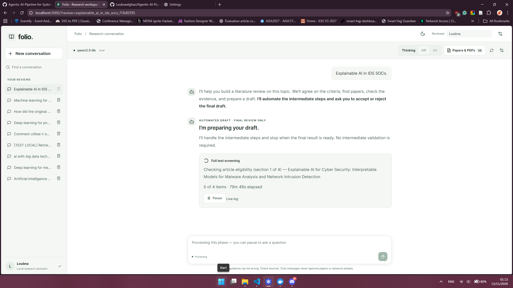

*Figure 10. Automatic full-text screening during the XAI/IDS case study. The workspace displays the research topic, the local Qwen3.5 4B model and the title of the article being assessed.*

The progress card identifies the current activity: checking the eligibility of an article from its full text. The displayed section counter refers to processing within that article, not to the total number of articles in the review. **Pause** allows the researcher to request a stop at a saved checkpoint, while **Live log** provides execution details. In this mode, intermediate decisions are machine proposals and the researcher reviews the final draft. The screenshot records an earlier screening step; it does not represent the latest run status or a completed review. Its elapsed time is not the total duration across pauses and resumed runs.

**Access to original publications**

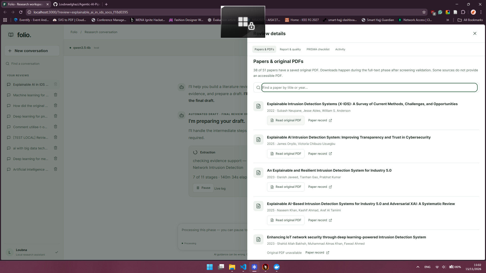

*Figure 11. Retrieved publications and original PDF access. At this point, 38 of the 51 bibliographic records have a saved original PDF.*

The **Papers & PDFs** panel lets the researcher search publications by title or year, inspect authors and publication dates, open a saved original PDF, and follow the source record. Unavailable PDFs are explicitly identified rather than silently removed. This supports source checking and helps distinguish an access problem from a scientific exclusion. **38 available PDFs does not mean 38 included studies**: eligibility is assessed separately, and some reports remain uncertain or are excluded.

**Search and selection diagram**

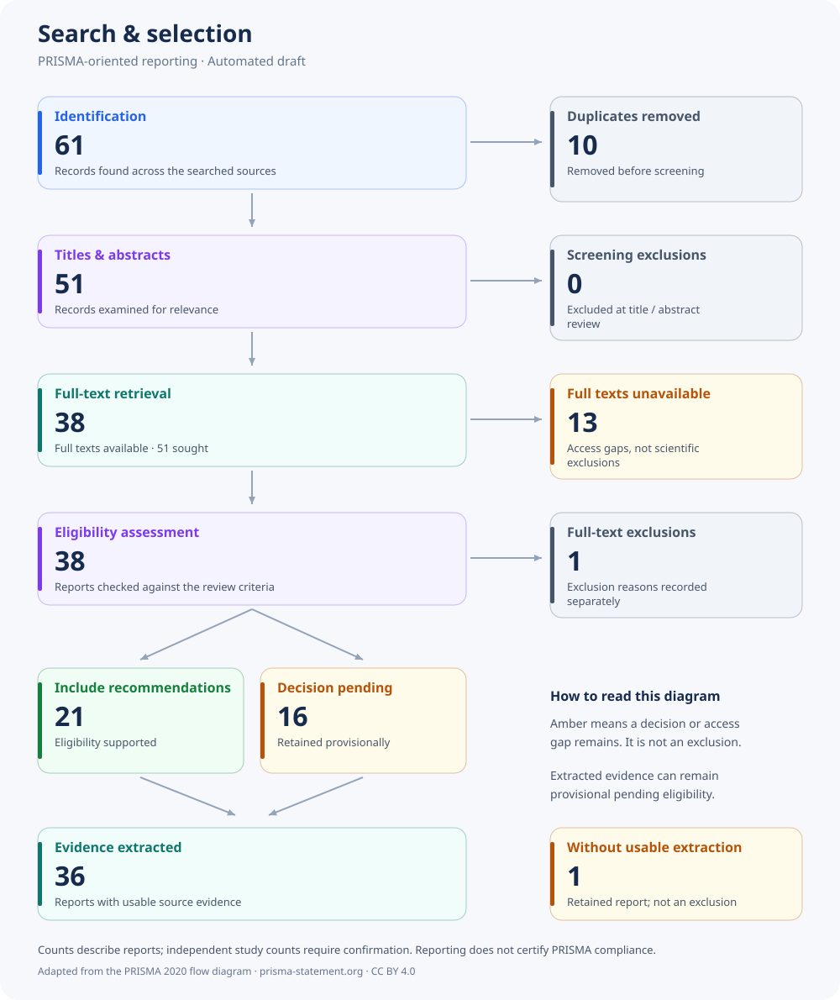

*Figure 12. PRISMA-oriented selection flow for the automatic XAI/IDS case study. Counts describe bibliographic records and reports, not confirmed independent studies. The diagram is exported separately for readability; its [count data](assets/figures/xai-selection-counts.json) and [PNG version](assets/figures/xai-selection-flow.png) are available.*

The sources returned **61 records**. Removing **10 duplicates** left **51** for title/abstract screening. Full texts were retrieved for **38** reports; **13** remained unavailable. Full-text assessment produced **21 include recommendations**, **16 uncertain cases** and **1 exclusion**. The uncertain cases were retained provisionally. Of the **37 reports processed for extraction**, **36 contain retained source quotations** and **one contains no verified quotation**. The last two boxes keep this evidence gap separate from scientific exclusions. The diagram does not certify PRISMA compliance or human validation. The completed manuscript export is linked below.

#### Exported XAI manuscript

Read the [scientific manuscript in Markdown](examples/xai-ids/automatic_review.md) or download its [Word version](examples/xai-ids/automatic_review.docx). The example also includes [BibTeX references](examples/xai-ids/references.bib) and the [selection diagram](examples/xai-ids/prisma_flow.svg).

The manuscript contains a structured abstract, introduction, methods, results, study tables, discussion, limitations, conclusion and references. The five generated narrative sections passed the implemented source audits. The Word export contains native tables and an embedded figure; its actual text was checked against the saved scientific sections. Only the **21 include-recommended reports** support the primary conclusions. The **16 unresolved reports** are reported separately; one retained report has no usable extraction.

**How to inspect this example:** read the selection counts, compare a result paragraph and its citation with the original source in the local application, then inspect the separate technical report for processing details and unresolved quality findings. The source-specific automated critic did not complete every comparison. This example is therefore an **AI-generated draft awaiting scientific review**, not a researcher-approved or publication-ready systematic review. Original source PDFs and local processing records are not distributed with the example.

A separate video of no more than three minutes, recorded by the researcher, demonstrates the workflow and its outputs. These illustrations complement the numerical results and human reference checks.

### Metric definitions

For screening, an included paper is the positive class:

- **TP:** human includes the paper and the system includes it.
- **FP:** human excludes the paper but the system includes it.
- **FN:** human includes the paper but the system excludes it or returns uncertain, under strict scoring.

| Metric | Definition | Interpretation |
| --- | --- | --- |
| Screening precision | `TP / (TP + FP)` | How many system inclusions match the human inclusion decisions? |
| Screening recall | `TP / (TP + FN)` | How many human-included papers receive a definite system inclusion? |
| F1 | `2 × TP / (2 × TP + FP + FN)` | Balance between precision and recall |
| Accuracy | Correct include/exclude decisions divided by all labelled records | Overall strict decision accuracy; uncertain predictions count as incorrect |
| Decision coverage | Non-uncertain predictions divided by all records | How often the system reaches a definite decision |
| Retention recall | Human-included papers not excluded by the system, divided by all human-included papers | Relevant papers preserved for further review, including uncertain cases |
| Simulated reviewer agreement | Matching decisions divided by records with two reviewer decisions | Consistency between the two model roles |
| Cohen's kappa | `(observed agreement − expected agreement) / (1 − expected agreement)` | Agreement adjusted for the reviewers' label frequencies |
| Citation correctness rate | Positive human citation ratings divided by all completed citation ratings | Record-level judgement of whether the cited evidence is correct |
| Extraction correctness rate | Positive human extraction ratings divided by completed extraction ratings | Record-level correctness of extracted information |
| Required-field completeness rate | Positive completeness ratings divided by completed completeness ratings | Record-level assessment of whether the required fields are complete |
| Time savings fraction | `1 − automated_seconds / manual_seconds` | Relative time saved for the same measured task; multiply by 100 for a percentage |
| Passage recall@k | Reference quotations found in the top-k passages divided by all reference quotations | Coverage of annotated evidence inside an acquired paper |
| Mean reciprocal rank | Mean of `1 / rank` for the first relevant passage; zero if none is retrieved | How early useful evidence appears in retrieval results |

Undefined metrics are reported as `null`, not invented zeroes. Each rating rate is accompanied by its number of rated samples. Inter-agent agreement is not independent human agreement.

**Completeness has two levels.** Extraction completeness asks whether required information was recovered from the reviewed papers. Search completeness asks whether relevant papers were found at all. Recall within the system's own retrieved sample does not establish search completeness. A search evaluation needs an independently assembled reference set or a documented manual search.

## 13. Repository structure

```text
agentic-review/
├── agents/                 # Specialized generation and validation roles
├── api/                    # FastAPI routes, jobs, and artifact access
├── evaluation/             # Human-reference metrics and inspection tools
├── frontend/
│   ├── src/                # React interface and typed API client
│   ├── server.mjs          # Production static server and runtime configuration
│   └── Dockerfile          # Frontend image build
├── methodology/            # Protocol, appraisal, scientific reporting, DOCX, citations
├── rag/                    # Indexing, hybrid retrieval, reranking, PDF provenance
├── scripts/                # WSL startup and local model diagnostics
├── storage/                # Review persistence and human decision history
├── tests/                  # Backend regression tests and fixtures
├── tools/                  # Academic APIs and full-text acquisition
├── .env.example            # Documented configuration template
├── compose.yaml            # Backend/frontend service definitions
├── Dockerfile              # Backend image build
├── main.py                 # Create or resume a review from the CLI
├── human_review.py         # Inspect and record human decisions from the CLI
├── pyproject.toml          # Python dependencies and tooling configuration
├── uv.lock                 # Python dependency lockfile
└── README.md               # Project description, setup, user guide, and evaluation
```


## 14. Scope and limitations

- Search coverage depends on the selected databases, queries, years, API responses, and record limits. No exhaustive-search guarantee is made.
- Source connectors currently cover OpenAlex, PubMed, and arXiv. Other databases require additional integration.
- PDFs may be inaccessible, scanned, poorly structured, or missing useful text. Parsing and source-boundary detection have limits.
- Writer, screeners, and auditors can share one model, so their errors may be correlated.
- Appraisal profiles are project-defined; formal instrument use and certainty-of-evidence assessment require appropriate research methods.
- The automatic final critic uses bounded extracted evidence. It cannot detect every omission or unsupported interpretation.
- Human approval must follow actual review. The interface does not replace subject expertise or independent dual review.
- Automatic writing produces a scientific draft; author verification is required before academic or publication use.
- The application is designed for a local, single-user deployment. Authentication and distributed job coordination are outside the current scope.

## 15. Conclusion

Folio brings the main stages of a systematic literature review into one traceable workflow: protocol definition, academic search, screening, source extraction, appraisal, synthesis, scientific writing, and export. Guided mode makes researcher decisions explicit, while Automated draft mode prepares a draft without intermediate human approvals. Both modes preserve source evidence and execution records.

The architecture separates the user interface, review orchestration, retrieval, local inference, persistence, and reporting. Two Docker images package the application; the host Ollama service supplies generation and embeddings. Source-linked paragraphs, readable research tables, selection diagrams, Word exports, and a separate technical report make the result easier to examine and reuse.

The evaluation framework connects the implementation to measurable criteria: screening precision and recall, extraction and citation correctness, completeness, simulated reviewer consistency, retrieval quality, and comparable task timings. Results must be calculated from actual reference annotations and recorded runs. Neither a polished manuscript nor agreement between model roles is a substitute for scientific validation.

The project's contribution is an inspectable, resumable environment for AI-assisted review preparation. Its scientific reliability depends on the protocol, search coverage, available texts, evidence checks, and researcher judgement. This defines both the practical value of the system and the boundaries within which its outputs should be interpreted.

## 16. References

- [PRISMA 2020 checklist](https://www.prisma-statement.org/prisma-2020-checklist) — reporting guidance; exported diagram attribution is retained.
- [LangGraph documentation](https://docs.langchain.com/oss/python/langgraph/overview) — stateful workflow orchestration.
- [Ollama documentation](https://docs.ollama.com/quickstart) and [server configuration](https://docs.ollama.com/faq) — local inference setup and diagnostics.
- [Docker Compose documentation](https://docs.docker.com/compose/gettingstarted/) — service builds and execution.
- [OpenAlex search documentation](https://help.openalex.org/api/searching/) — academic search and Boolean query syntax.
- [PROBAST+AI](https://doi.org/10.1136/bmj-2024-082505) — prediction-model appraisal guidance; the project rubric is not a full implementation of this tool.
- [QUADAS-2 guidance](https://www.bristol.ac.uk/population-health-sciences/projects/quadas/history/quadas-2/) — historical diagnostic-accuracy appraisal guidance; use an appropriate instrument for the review design.
