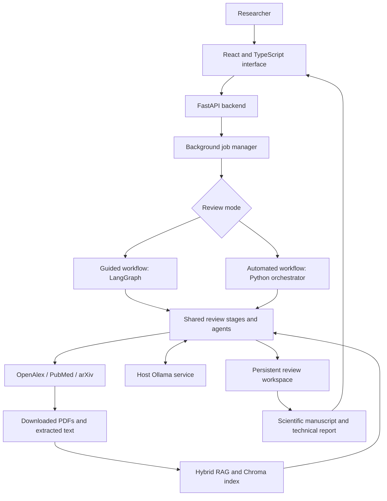

# Folio — Agentic AI for Systematic Literature Reviews

**From a research question to a source-linked scientific manuscript.**

Academic project: **Development of an Agentic AI Pipeline for Conducting Rigorous, Transparent, and Reproducible Systematic Reviews on Any Given Topic.**

Folio is a local research application that helps users search scientific literature, select relevant papers, extract evidence, assess study quality, and write a review manuscript. It combines specialized AI agents, a retrieval-augmented generation pipeline, and a browser interface for reading sources and reviewing decisions.

The system supports two working modes: **Guided**, with human decisions at key stages, and **Automated draft**, which runs the intermediate stages and asks the user to accept or reject the final result.

The main output is a **scientific manuscript about the research topic**. A separate **technical and reproducibility report** explains the search process, model settings, checks, and execution details. Both can be downloaded as Word documents.

> Folio produces an AI-assisted review draft with traceable evidence. Final acceptance of a draft does not certify every claim, a complete literature search, or compliance with all PRISMA requirements.

## Table of contents

1. [Project purpose](#1-project-purpose)
2. [Features and scope](#2-features-and-scope)
3. [System architecture](#3-system-architecture)
4. [Agents and responsibilities](#4-agents-and-responsibilities)
5. [Review workflow](#5-review-workflow)
6. [Models and retrieval](#6-models-and-retrieval)
7. [Installation with Docker](#7-installation-with-docker)
8. [Configuration](#8-configuration)
9. [User guide](#9-user-guide)
10. [Reports and exported files](#10-reports-and-exported-files)
11. [Evidence checks and PRISMA reporting](#11-evidence-checks-and-prisma-reporting)
12. [Evaluation methodology and metrics](#12-evaluation-methodology-and-metrics)
13. [Software tests](#13-software-tests)
14. [Persistence and reproducibility](#14-persistence-and-reproducibility)
15. [Local development and CLI](#15-local-development-and-cli)
16. [Repository structure](#16-repository-structure)
17. [Troubleshooting](#17-troubleshooting)
18. [Scope and limitations](#18-scope-and-limitations)
19. [Academic deliverables](#19-academic-deliverables)
20. [References](#20-references)

## 1. Project purpose

A systematic review follows an explicit process to find, select, assess, and summarize research that answers a question. Folio supports this process through a modular multi-agent architecture.

The project addresses the following objectives:

- Turn a topic into a configurable review protocol.
- Build search strategies and retrieve records from academic sources.
- Apply inclusion and exclusion criteria with recorded reasons.
- Retrieve full texts and extract evidence linked to source passages.
- Support study appraisal and narrative synthesis.
- Generate a scientific manuscript, evidence tables, references, and selection diagrams.
- Keep decisions, intermediate artifacts, and execution traces available for inspection.
- Support both automation and human oversight.

**Example input:** “How is deep learning used to detect pneumonia in chest X-ray images?”

**Example outputs:** a review manuscript with an abstract, methods, findings, discussion, and conclusion; study tables; a PRISMA-style flow diagram; bibliographic references; and a separate technical report.

The architecture accepts different research topics. Users must adapt search terms, eligibility criteria, extraction fields, and appraisal domains to their subject.

## 2. Features and scope

| Area | What Folio provides |
| --- | --- |
| Review setup | Research question, rationale, criteria, sources, publication years, record limits, extraction fields, and synthesis plan |
| Academic discovery | OpenAlex, PubMed, and arXiv connectors with search logs and deduplication |
| Screening | Two blinded prompt roles for title/abstract screening, followed by full-text eligibility assessment |
| Evidence extraction | Source quotations, PDF page references, structured evidence, and numerical table extraction |
| RAG | Dense and lexical retrieval, rank fusion, optional LLM reranking, and extractive context compression |
| Study appraisal | Configurable domains, source-supported machine proposals, and explicit human assessments in Guided mode |
| Scientific writing | Evidence-based introduction, results, discussion, conclusion, and abstract; methods derived from review records |
| Quality checks | Citation and number checks, semantic support audits, and manuscript criticism |
| Reporting | Markdown, DOCX, BibTeX, CSV evidence tables, PRISMA flow data, and SVG/PNG diagrams |
| User experience | Chat workspace, original PDF reader, step-by-step decisions, progress, pause/resume, and downloads |
| Auditability | Saved checkpoints, model configuration, decision history, artifact versions, and execution traces |

## 3. System architecture



### Application layers

| Layer | Technology | Responsibility |
| --- | --- | --- |
| Browser interface | React, TypeScript, Vite | Configure reviews, read papers, record decisions, and display reports |
| HTTP API | FastAPI and Pydantic | Validate requests, expose review data, and serve artifacts |
| Job execution | Background worker and subprocesses | Run one workflow job at a time, preserve logs, and handle safe pauses |
| Guided orchestration | LangGraph | Manage stage transitions, saved state, and human review gates |
| Automatic orchestration | Python workflow runner | Execute the shared stages without intermediate human approvals |
| Model integration | LangChain components and LangChain Ollama | Structured model calls and local inference |
| Knowledge retrieval | Chroma and custom retrieval modules | Index passages and retrieve evidence for each paper |
| Document processing | PyMuPDF | Read PDFs, locate passages, render pages, and extract tables |
| Reporting | Python exporters and Word document generation | Produce Markdown, DOCX, BibTeX, CSV, and diagrams |

**An agent is a specialized role**, with its own instructions, inputs, output schema, and checks. The agents can share the same underlying LLM. A multi-agent architecture does not require one separately installed model per agent.

The workflow is mostly a predefined sequence with conditional review gates. It does not freely invent a new execution plan for every question.

## 4. Agents and responsibilities

Some roles are implemented as LLM agents; others combine deterministic tools and workflow functions.

| Role | Main input | Responsibility and output | Implementation |
| --- | --- | --- | --- |
| Coordinator | Review state and configuration | Schedules stages, saves progress, resumes work, and routes human decisions | [Guided graph](workflow/graph.py), [automatic runner](workflow/automatic.py), [job manager](api/jobs.py) |
| Planner | Research topic | Proposes a question, rationale, eligibility criteria, concept groups, and an appraisal profile | [planner_agent.py](agents/planner_agent.py) |
| Search strategy | Protocol concepts and synonyms | Builds source-specific queries, including Boolean expressions and optional MeSH terms | [protocol.py](methodology/protocol.py); [search_agent.py](agents/search_agent.py) also provides a query-generation helper |
| Retrieval | Search strategies and source settings | Calls academic APIs, records provenance, deduplicates records, and prepares index construction | [search.py](tools/search.py), [ingest.py](rag/ingest.py) |
| Title/abstract screeners | Title, abstract, and protocol criteria | Produce two blinded screening proposals with reasons and criterion references | [screening_agent.py](agents/screening_agent.py) |
| Full-text screener | Full text and eligibility criteria | Checks criteria against source passages and audits ambiguous or conflicting decisions | [full_text_agent.py](agents/full_text_agent.py), [eligibility_audit.py](agents/eligibility_audit.py) |
| Extraction | Relevant passages and source tables | Selects quotations, proposes structured fields, and retains numerical results with source locations | [extraction_agent.py](agents/extraction_agent.py), [tables.py](rag/tables.py) |
| Appraisal | Study text, evidence, and configured domains | Proposes domain judgements with source support; disagreements and missing support remain unclear | [appraisal_agent.py](agents/appraisal_agent.py), [appraisal.py](methodology/appraisal.py) |
| Synthesis | Eligible evidence and study information | Builds source-linked evidence summaries and comparative narrative proposals | [synthesis_agent.py](agents/synthesis_agent.py), [narrative_agent.py](agents/narrative_agent.py) |
| Scientific writer | Eligible source-linked facts | Drafts the scientific sections and checks each paragraph before inclusion | [writing_agent.py](agents/writing_agent.py) |
| Critic / quality assurance | Manuscript, evidence, and protocol | Checks consistency and support; identifies located contradictions, omissions, and overgeneralizations | [critic_agent.py](agents/critic_agent.py), [scientific_qa.py](agents/scientific_qa.py) |
| Conversational assistant | User question and available review context | Explains the workflow and answers questions; chat messages do not approve research decisions | [chat_agent.py](agents/chat_agent.py) |

The two screening roles use the same local model with different prompts. Their agreement measures **simulated inter-agent consistency**, not agreement between independent human reviewers.

## 5. Review workflow


| Step | What happens | What the user can inspect |
| --- | --- | --- |
| 1. Define scope | A protocol records the question, criteria, sources, dates, and planned methods | Protocol and revisions |
| 2. Search | Queries are sent to the selected academic sources | Queries, dates, results, limits, and source errors |
| 3. Deduplicate | Records are compared using identifiers and normalized bibliographic information | Retained records and duplicates |
| 4. Screen abstracts | Two prompt roles assess eligibility | Decisions, reasons, disagreements, and missing information |
| 5. Acquire full texts | The system attempts to obtain available papers | Original PDFs and acquisition outcomes |
| 6. Assess eligibility | Full-text passages are compared with protocol criteria | Include, exclude, or uncertain proposals and supporting passages |
| 7. Index and extract | Relevant passages and source table rows are retrieved and checked | Evidence tables, quotations, numerical values, and pages |
| 8. Appraise studies | Study quality is assessed under the configured rubric | Domain proposals and human assessments where recorded |
| 9. Write | Eligible evidence supports the scientific narrative | Five generated section checks and the manuscript |
| 10. Check and export | Quality checks and reporting artifacts are produced | Manuscript, technical report, references, diagrams, and audit files |

An unavailable PDF is an **access gap**, not a scientific exclusion. A missing extraction is a processing gap. An uncertain eligibility decision means that the available evidence does not support a clear decision under the criteria.

### Guided and automatic modes

| Behaviour | Guided | Automated draft |
| --- | --- | --- |
| Protocol | User edits and explicitly approves | Planner creates a machine proposal |
| Intermediate phases | Pause for phase confirmations and required item decisions | Run without intermediate human validation |
| Eligibility and evidence | Human decisions control inclusion and approved evidence | Machine proposals remain labelled as machine proposals |
| Appraisal | User records study/domain assessments | System records source-supported domain proposals |
| Final action | Review the manuscript and confirm completion | Accept or reject the overall draft |
| Meaning of acceptance | A recorded user decision within the workflow | Acceptance of the draft, not individual certification of all claims |

In Guided mode, **Confirm & continue** does not replace the required decisions for individual items. In automatic mode, the system never creates fictitious human protocol approvals, evidence approvals, or study appraisals.

## 6. Models and retrieval

### Default local models

| Component | Default | Purpose |
| --- | --- | --- |
| Generation LLM | `qwen3.5:4b` | Planning, screening, extraction proposals, appraisal, writing, and model-based checks |
| Embedding model | `qwen3-embedding:0.6b` | Converts passages and queries into vectors for semantic retrieval |
| Context budget | `8192` tokens | Shared context setting for generation calls |
| Embedding GPU setting | `EMBEDDING_NUM_GPU=0` | Runs embedding inference on CPU to leave GPU memory for generation |
| Temperature | `0` in new-review defaults | Reduces variation in structured research tasks; it does not guarantee correctness |
| Thinking | Off in the default review setup | Keeps ordinary calls bounded; disputed eligibility has a separate audit-reasoning setting |

The local development setup used an NVIDIA RTX 4060 Laptop GPU with 8 GB VRAM. This is a deployment example, not a universal hardware requirement or speed guarantee. Actual memory and latency depend on model quantization, context length, available RAM, and the number of passages processed.

Folio uses the models selected in configuration. It does not download models automatically or silently switch to a larger model. A model change must remain traceable. Changing the embedding model creates a separate index identity rather than mixing incompatible vectors.

### How hybrid RAG works

RAG means retrieving relevant source text before asking the model to reason or write.

1. Extract text from downloaded papers and divide it into passages.
2. Store passage embeddings and metadata in Chroma.
3. Retrieve semantically similar passages through dense vector search.
4. Retrieve passages through a BM25-like lexical scoring method.
5. Combine the rankings with reciprocal rank fusion.
6. Optionally ask the local LLM to rerank the candidates.
7. Keep a bounded, source-exact text window as context.
8. Match selected quotations to the source and retain PDF page locations when available.

Academic discovery finds **papers**. RAG finds **passages inside the acquired papers**. Passage retrieval does not prove that the bibliographic search found every relevant study.

## 7. Installation with Docker

### Requirements

- Git.
- Docker Engine with Compose, or Docker Desktop with the WSL integration enabled when using WSL.
- A running Ollama installation with the two configured local models.
- Internet access for installation, academic APIs, and PDF downloads.
- Enough disk space for container images, model weights, PDFs, and vector indexes.

Python and Node do not need to be installed on the host for the Docker application. Ollama runs separately on the host in this Compose setup.

### Step 1 — Clone the repository

```bash
git clone https://github.com/Loubnaelghazi/Agentic-AI-Pipeline-for-Systematic-Reviews-on-Any-Given-Topic-End-to-End-Project.git agentic-review
cd agentic-review
```

### Step 2 — Create the configuration

On a fresh clone:

```bash
cp .env.example .env
```

For an existing installation, keep the current `.env` and compare it with [.env.example](.env.example). Do not commit `.env` or API keys.

### Step 3 — Prepare Ollama

Install and start [Ollama](https://docs.ollama.com/quickstart), then download the default models:

```bash
ollama pull qwen3.5:4b
ollama pull qwen3-embedding:0.6b
ollama list
```

Ollama must accept connections from the backend container. `127.0.0.1` inside a container refers to that container, not the host. Configure the reachable address through `DOCKER_OLLAMA_BASE_URL`; the default is `http://host.docker.internal:11434`.

If the host service only listens on an unreachable loopback interface, configure its bind address for your Docker network and restart Ollama. Use the [Ollama server configuration guide](https://docs.ollama.com/faq) and keep access limited to the intended local environment.

### Step 4 — Build and start

```bash
docker compose up -d --build --wait
docker compose ps
```

Open:

| Service | Address |
| --- | --- |
| Application | [http://localhost:3000](http://localhost:3000) |
| API documentation | [http://localhost:8000/docs](http://localhost:8000/docs) |
| API health | [http://localhost:8000/api/health](http://localhost:8000/api/health) |
| Model readiness | [http://localhost:8000/api/runtime](http://localhost:8000/api/runtime) |

A healthy API means the HTTP service is running. Check `/api/runtime` as well to confirm that Ollama and the configured models are available.

### Docker images and services

| Service | Build definition | Runtime | Port | Persistent data |
| --- | --- | --- | --- | --- |
| Backend | [Dockerfile](Dockerfile) | Python 3.12, FastAPI, one Uvicorn worker | `8000` | Host `./data` mounted at `/data` |
| Frontend | [frontend/Dockerfile](frontend/Dockerfile) | Node 22 serving compiled React assets | `3000` | Review data is stored by the backend |

Both images use multi-stage builds and non-root runtime users. Python dependencies are installed from `uv.lock`; frontend dependencies use `package-lock.json`. Compose builds the application images locally; this setup does not require a pre-published project image from Docker Hub.

Ollama is **not a third Compose service**. Model weights are managed by the host Ollama installation and are not bundled inside the application images. GPU inference happens through that host service; the Python container does not require its own CUDA model installation.

The frontend serves static assets and runtime configuration. The browser calls FastAPI directly; there is no Nginx or backend reverse proxy in this stack. Compose publishes the ports on the host loopback interface.

### Stop, restart, and update

```bash
# Stop the application and preserve saved reviews.
docker compose stop

# Start the existing services again.
docker compose up -d --wait

# Rebuild after source changes, when no workflow is running.
docker compose up -d --build --wait

# Inspect logs and images.
docker compose logs --tail=100 backend frontend
docker compose images
```

### WSL startup helper

For the private WSL Ollama service configuration supported by this repository:

```bash
sh scripts/start-local.sh --wait
```

The helper refreshes the configured private WSL address when the corresponding systemd override exists. It also recreates the backend if Docker Desktop restores an empty data bind mount. It does not install Docker, Ollama, models, or the systemd override on a new machine.

## 8. Configuration

[.env.example](.env.example) documents the environment settings. Review-specific settings are selected in the browser and saved with the review.

| Setting | Default / example | Meaning |
| --- | --- | --- |
| `OLLAMA_MODEL` | `qwen3.5:4b` | Default generation model |
| `EMBEDDING_MODEL` | `qwen3-embedding:0.6b` | Passage/query embedding model |
| `OLLAMA_BASE_URL` | `http://127.0.0.1:11434` | Ollama address for local Python execution |
| `DOCKER_OLLAMA_BASE_URL` | `http://host.docker.internal:11434` | Ollama address used by the container |
| `OLLAMA_NUM_CTX` | `8192` | Generation context budget |
| `EMBEDDING_NUM_GPU` | `0` | CPU embedding inference to reserve VRAM |
| `OLLAMA_AUDIT_REASONING` | `true` | Careful reasoning for disputed eligibility, where supported |
| `OLLAMA_REQUEST_TIMEOUT` | `300` seconds | Default inference request timeout |
| `OLLAMA_RETRY_ATTEMPTS` | `2` | Maximum attempts for supported transient failures |
| `RERANK_ENABLED` | `true` | Optional LLM passage reranking |
| `API_BASE_URL` | `http://localhost:8000` | API address that the browser can reach |
| `CORS_ORIGINS` | Local development origins | Browser origins allowed to call the API |
| `DATA_DIR` | Local `data/`; `/data` in Compose | Persistent review storage |
| `LOCAL_UID`, `LOCAL_GID` | `1000` | Backend image user IDs for bind-mount permissions |
| `OPENALEX_API_KEY` | Empty | Metadata API credential, when required by the provider |
| `OLLAMA_HOST_ADDRESS` | Empty | Optional host mapping for private WSL routing |

If your Linux user IDs differ from `1000`, set `LOCAL_UID` and `LOCAL_GID` before building. Use `id -u` and `id -g` to inspect them.

In the browser, Settings provides model choice, run mode, thinking, temperature, record limits, years, and sources. Both year fields blank means no date restriction. One-sided date ranges are supported. OpenAlex and PubMed use publication dates; arXiv uses submission dates.

The record limit applies **per query**, not to the entire review. Small limits are useful for a smoke test but can reduce literature coverage. Start a new review when changing the search configuration after processing has begun.

## 9. User guide

### Start a review

1. Open the application and select a new conversation.
2. Open **Settings** in the prompt box.
3. Choose the model, mode, sources, years, and record limit.
4. Enter a focused research question and submit it.
5. Follow the current action card in the conversation.

For a short functional test, use a narrow question and a small record limit. For a substantive review, define and justify coverage rather than treating the test settings as an exhaustive search.

### Guided mode: step by step

| Phase | User action |
| --- | --- |
| Protocol | Create a template or request a planner suggestion. Read and edit the question, criteria, synonyms, dates, extraction fields, and appraisal rubric. Save and explicitly approve it. |
| Search results | Inspect the retrieved records and source logs. Confirm the phase to start screening. |
| Screening | Resolve the requested decisions using the title, abstract, and criteria. Save each decision, then confirm the phase. |
| Full-text eligibility | Read the original papers and supporting passages. Include or exclude reports against the protocol. Full-text exclusions require a reason. |
| Evidence review | Check quotations, attribution, categories, values, and page references. Approve or reject the evidence items. |
| Study appraisal | Review study characteristics and each appraisal domain. Record your own judgement and supporting source quotation where required. AI proposals do not fill in human approval. |
| Manuscript | Read the scientific draft, quality notes, tables, and references. Review the PRISMA checklist and confirm the final phase. |

Enter your reviewer name when recording decisions. **Save & next** saves an item and advances the queue. **Skip for now** leaves it undecided. Required pending decisions must be finished before confirming the phase.

### Automated draft: step by step

1. Select **Automated draft** before submitting the question.
2. Let the system run planning, search, screening, acquisition, extraction, appraisal, writing, and checks.
3. Read the manuscript and technical report when generation finishes.
4. Inspect the original papers and any uncertain or flagged findings.
5. Choose **Accept final result** or **Reject final result**.

Final acceptance applies to the overall draft. It does not create intermediate human approvals. Reports with unresolved eligibility are kept separate from the evidence supporting primary conclusions.

### Read papers and follow progress

- **Papers & PDFs** opens the paper library.
- **Read original PDF** provides page navigation and zoom while preserving source layout.
- **Browser PDF view** and **Download PDF** provide access to the saved original file.
- The progress card shows the current operation and available per-paper counts.
- **Activity** provides the execution log.
- **Pause to review** requests a pause at a safe boundary; a model call may finish before the pause takes effect.
- **Resume** reuses completed stages and checkpoints, although unfinished operations may run again.

The chat assistant can explain a stage, but writing “approve” in chat does not record a scientific decision. Use the dedicated review buttons.

## 10. Reports and exported files

### Scientific manuscript

The manuscript concerns the **research question and included studies**. Its structure includes:

1. Structured abstract.
2. Introduction and review objective.
3. Methods and eligibility criteria.
4. Results, selection flow, study characteristics, and findings.
5. Discussion and interpretation.
6. Study and review limitations.
7. Conclusion.
8. Declarations and references.

Word exports use scientific document styling, native tables, captions, page numbers, and an embedded selection diagram. The writing agent generates five narrative sections; the methods and selection counts are built from the review records.

### Technical and reproducibility report

This separate report describes the model configuration, execution trace, source excerpts, appraisal proposals, search details, quality findings, and operational limitations. It allows a reader to inspect how the manuscript was produced without turning the scientific discussion into a report about the software.

### Artifact reference

Files are stored under `data/reviews/REVIEW_ID/outputs/`. Some are mode-specific or appear only after the relevant stage completes.

| Artifact | Purpose |
| --- | --- |
| `automatic_review.md`, `automatic_review.docx` | Scientific manuscript from Automated draft mode |
| `literature_review.md`, `literature_review.docx` | Scientific manuscript from Guided mode |
| `technical_report.md`, `technical_report.docx` | Separate technical and reproducibility report |
| `references.bib` | BibTeX bibliography |
| `evidence_table.csv`, `evidence.json` | Extracted evidence and supporting source passages |
| `approved_evidence.json` | Human-approved evidence in Guided mode |
| `numerical_results.csv` | Source numerical table results |
| `full_text_decisions.csv` | Automatic report-level eligibility and exclusion details |
| `prisma_flow.json`, `prisma_flow.svg`, `prisma_flow.png` | Selection counts and diagram |
| `prisma_checklist.json` | Reporting checklist and recorded assessments |
| `evidence_map.csv`, `evidence_map.svg` | Evidence maps produced by Guided reporting |
| `search_strategy.json`, `search_log.json` | Search queries, source responses, dates, and coverage notes |
| `retrieved_records.json`, `duplicates.json` | Retrieval provenance and deduplication records |
| `automatic_appraisal.json`, `appraisal_proposals.json` | Machine appraisal proposals by mode |
| `appraisals.json`, `human_decisions.json` | Recorded human assessments and decisions |
| `scientific_manuscript.json` | Writing checkpoints, paragraph evidence links, accepted and rejected drafts |
| `scientific_quality.json` | Located scientific criticism and completion/failure details |
| `automatic_quality.json`, `quality_review.json` | Mode-specific quality summaries |
| `execution_trace.json`, `runs/` | Stage timings, outcomes, and worker logs |
| `meta_analysis_template.csv` | Guided reporting template for quantitative preparation |

The Word document is the convenient reading copy. The JSON and CSV files provide the detailed audit trail.

## 11. Evidence checks and PRISMA reporting

### Evidence controls

The system combines deterministic checks with model-based audits:

- Compare decisions with explicit criterion identifiers.
- Challenge disputed eligibility and preserve unresolved cases as uncertain.
- Match selected quotations to retrieved passages and original PDF text.
- Retain PDF page references when they can be verified.
- Preserve table headers, units, decimals, and source geometry.
- Check paragraph citations and unsupported numerical values.
- Audit semantic support and attribution before accepting generated prose.
- Retain rejected drafts and failed checks for inspection.
- Locate manuscript criticism in actual manuscript and evidence passages.

These checks reduce identifiable errors. Exact source matching alone does not establish that a quotation is relevant, that its interpretation is correct, or that it describes the current study rather than cited work.

### Appraisal approach

The planner can propose a general, prediction-model, or diagnostic-accuracy rubric. Users can edit the domains in the protocol. Machine proposals use `low`, `high`, or `unclear` judgements with source support; missing support and disagreement remain unclear.

These are **project-defined rubrics**, not full implementations of validated clinical instruments. A formal risk-of-bias assessment requires an appropriate instrument and researcher review. Prediction-model and diagnostic-study guidance are linked in the [references](#20-references).

### PRISMA-oriented reporting

Folio keeps identified records, duplicates, screening exclusions, access failures, full-text exclusions, unresolved eligibility, and retained reports separate. Count checks help detect inconsistent flows.

The checklist provides review items and suggested manuscript locations. Users assess the reporting and record explanations. The diagram is adapted from PRISMA 2020 with attribution in the exported figure. **A diagram or completed export is not an automatic certificate of PRISMA compliance.**

Reports and independent studies are different units. Several reports may describe one study. Confirmed study identifiers are needed before interpreting report counts as independent study counts.

## 12. Evaluation methodology and metrics

The evaluation separates **software correctness** from **scientific performance**. Passing a regression test does not measure screening accuracy on real literature.

The academic evaluation addresses completeness, accuracy, inter-agent consistency, and time savings against a manual reference. The tools calculate results from actual annotations; this README does not supply assumed scientific scores.

### Metric definitions

For screening, an included paper is the positive class:

- **TP:** human includes the paper and the system includes it.
- **FP:** human excludes the paper but the system includes it.
- **FN:** human includes the paper but the system excludes it or returns uncertain, under strict scoring.

| Metric | Definition | Interpretation |
| --- | --- | --- |
| Screening precision | `TP / (TP + FP)` | How many system inclusions match the human inclusion decisions? |
| Screening recall | `TP / (TP + FN)` | How many human-included papers receive a definite system inclusion? |
| F1 | `2 × TP / (2 × TP + FP + FN)` | Balance between precision and recall |
| Accuracy | Correct include/exclude decisions divided by all labelled records | Overall strict decision accuracy; uncertain predictions count as incorrect |
| Decision coverage | Non-uncertain predictions divided by all records | How often the system reaches a definite decision |
| Retention recall | Human-included papers not excluded by the system, divided by all human-included papers | Relevant papers preserved for further review, including uncertain cases |
| Simulated reviewer agreement | Matching decisions divided by records with two reviewer decisions | Consistency between the two model roles |
| Cohen's kappa | `(observed agreement − expected agreement) / (1 − expected agreement)` | Agreement adjusted for the reviewers' label frequencies |
| Citation correctness rate | Positive human citation ratings divided by all completed citation ratings | Record-level judgement of whether the cited evidence is correct |
| Extraction correctness rate | Positive human extraction ratings divided by completed extraction ratings | Record-level correctness of extracted information |
| Required-field completeness rate | Positive completeness ratings divided by completed completeness ratings | Record-level assessment of whether the required fields are complete |
| Time savings fraction | `1 − automated_seconds / manual_seconds` | Relative time saved for the same measured task; multiply by 100 for a percentage |
| Passage recall@k | Reference quotations found in the top-k passages divided by all reference quotations | Coverage of annotated evidence inside an acquired paper |
| Mean reciprocal rank | Mean of `1 / rank` for the first relevant passage; zero if none is retrieved | How early useful evidence appears in retrieval results |

Undefined metrics are reported as `null`, not invented zeroes. Each rating rate is accompanied by its number of rated samples. Inter-agent agreement is not independent human agreement.

**Completeness has two levels.** Extraction completeness asks whether required information was recovered from the reviewed papers. Search completeness asks whether relevant papers were found at all. Recall within the system's own retrieved sample does not establish search completeness. A search evaluation needs an independently assembled reference set or a documented manual search.

### Prepare and evaluate a human reference sample

Use a new output directory for each evaluation. Replace `REVIEW_ID` with the identifier of a completed review. The commands below use the running backend container so that they share its configuration and saved data.

```bash
docker compose exec backend python -m evaluation.prepare \
  REVIEW_ID /data/evaluations/sample-01
```

This creates files in the host directory `data/evaluations/sample-01/`:

| File | Contents |
| --- | --- |
| `labels.json` | Blank human decisions, reviewer names, timings, and correctness ratings |
| `predictions.json` | System screening decisions, simulated reviewer decisions, and recorded timings |
| `reference_material.json` | Protocol, paper metadata, source evidence, and annotation instructions |

Evaluation procedure:

1. Read the protocol and define the task scope before looking at system decisions.
2. Read each title/abstract and record a human `include` or `exclude` label and reviewer name.
3. Measure actual manual screening time for the same records.
4. For accessible full texts, check the cited evidence, extracted results, and required fields. Record `true`, `false`, or leave an unassessed rating `null`.
5. Keep full-text verification time separate from a title/abstract screening time comparison.
6. Run the benchmark after completing the reference labels.

```bash
docker compose exec backend python -m evaluation.benchmark \
  /data/evaluations/sample-01/labels.json \
  /data/evaluations/sample-01/predictions.json \
  /data/evaluations/sample-01/results.json
```

The benchmark rejects missing human screening labels and mismatched sample identifiers. Missing timings leave time savings unknown. Report the question, protocol, sample size, sources, model, hardware, and annotation method alongside every result.

### Evaluate passage retrieval

Create `retrieval-labels.json` containing exact relevant quotations that occur in the indexed source passages:

```json
[
  {
    "query": "Describe the evaluation dataset and test split",
    "source": "PAPER_ID.txt",
    "relevant_quotes": ["An exact quotation copied from the source passage."],
    "reviewer": "Researcher name"
  }
]
```

Save it under `data/evaluations/sample-01/`, then run:

```bash
docker compose exec backend python -m evaluation.retrieval \
  REVIEW_ID \
  /data/evaluations/sample-01/retrieval-labels.json \
  /data/evaluations/sample-01/retrieval-results.json \
  --models qwen3-embedding:0.6b --k 5
```

The evaluator compares dense, hybrid, and reranked retrieval on the annotated queries. It records indexing time and retrieval latency. Use installed embedding models only. This is a within-paper retrieval evaluation.

### Inspect source and export integrity

```bash
docker compose exec backend python -m evaluation.audit_review \
  REVIEW_ID /data/evaluations/integrity-01
```

The inspection records available stage state, source checks, Word archive integrity, writing status, selection count checks, search coverage notes, reviewer agreement, and execution traces. It does not create human annotations. Optional `--inference --profile prediction` adds a separate machine appraisal and criticism audit; it uses the configured model and should run when the workflow is idle.

### Optional quantitative preparation

The system does not pool incompatible study results automatically. An optional fixed-effect inverse-variance tool accepts explicitly human-verified estimates with independent study IDs and a documented comparability assessment.

```bash
docker compose exec backend python -m evaluation.meta_analysis \
  /data/evaluations/verified-estimates.csv \
  --reviewer "Researcher name" \
  --comparability-reason "Documented assessment of study independence and comparable estimates" \
  --output /data/evaluations/pooled-result.json
```

Input columns are `study_id`, `outcome`, `effect_measure`, `comparison_group`, `human_verified`, `effect`, and `standard_error`. All rows must use compatible definitions and an appropriate common analysis scale. This optional utility is not a complete meta-analysis workflow.

## 13. Software tests

The regression suite covers both workflow modes, confirmation gates, source quotations, eligibility audits, appraisal failure cases, scientific writing, numerical values, export presentation, PRISMA counts, API behaviour, and recovery from interrupted operations.

For a local development environment:

```bash
uv sync --frozen
uv run python -m unittest discover -s tests -v
uv run ruff check agents rag workflow methodology evaluation api scripts tests config.py
uv run ruff format --check agents rag workflow methodology evaluation api scripts tests config.py
```

Frontend checks:

```bash
cd frontend
npm ci
npm test
npm run build
```

The frontend suite includes conversation flow, pending decisions, report rendering, PDF controls, configuration, and the static HTTP server. The production build also checks TypeScript.

Backend runtime images contain production dependencies, not the test suite or Ruff. Run backend regression tests from a development checkout. Test fixtures simulate model/API responses where appropriate; real model and source availability are checked separately through `/api/runtime` and an end-to-end review.

For a full demonstration, verify both modes, original PDF access, evidence-to-source links, report downloads, and persistence after restart. Save the exact test command, date, revision, and output when reporting test results. Scientific evaluation metrics come from the human-reference procedure above, not from the software test pass rate.

## 14. Persistence and reproducibility

```text
data/
└── reviews/
    └── REVIEW_ID/
        ├── topic.txt
        ├── protocol.json
        ├── papers.json
        ├── workflow_state.json
        ├── papers/                 # Acquired PDFs and extracted text
        ├── indexes/                # Model-specific Chroma indexes
        └── outputs/
            ├── ...                # Reports, decisions, evidence, and quality files
            ├── history/           # Archived outputs before invalidation
            └── runs/              # Worker logs
```

The `./data:/data` bind mount keeps review files outside container images. Stopping, recreating, or rebuilding containers preserves this host directory. Back it up before moving or manually changing research records.

Decision and protocol fingerprints help detect stale approvals. Relevant changes invalidate dependent outputs while retaining reusable acquisition and extraction work. The explicit generation-model migration also archives prior results and invalidates model-dependent proposals. It is blocked while that review is running.

A restart can interrupt a worker. Resume from the interface after Docker and Ollama are reachable. A saved checkpoint improves recovery; it does not guarantee byte-identical regeneration. Model updates, inference behaviour, and changing academic databases can affect later runs.

`.env`, review data, model audits, local backups, caches, and generated build output are excluded from Git. A fresh clone contains the implementation and configuration example, not private review workspaces or preinstalled models.

## 15. Local development and CLI

Requirements: Python 3.12+, [uv](https://docs.astral.sh/uv/), Node.js 20.19+ with a Vite-compatible release, npm, and Ollama.

Backend:

```bash
uv sync --frozen
uv run uvicorn api.app:app --host 127.0.0.1 --port 8000
```

Frontend, in a second terminal:

```bash
cd frontend
npm ci
npm run dev
```

Open [http://localhost:5173](http://localhost:5173). Configure `OLLAMA_BASE_URL` for the host Python process. The development browser API address is defined in `frontend/public/config.js`.

### CLI entry points

```bash
# Create a Guided review from the command line.
uv run python main.py --topic "Your research question"

# Resume an existing review in its saved mode.
uv run python main.py --review-id REVIEW_ID

# Inspect human review tasks.
uv run python human_review.py REVIEW_ID

# Inspect the protocol.
uv run python -m methodology.protocol show REVIEW_ID
```

The CLI enforces the same review prerequisites. Phase confirmations are available in the browser. Do not run a CLI writer while the API is processing or editing the same review.

## 16. Repository structure

```text
agentic-review/
├── agents/                 # Specialized generation and validation roles
├── api/                    # FastAPI routes, jobs, and artifact access
├── evaluation/             # Human-reference metrics and inspection tools
├── frontend/
│   ├── src/                # React interface and typed API client
│   ├── server.mjs          # Production static server and runtime configuration
│   └── Dockerfile          # Frontend image build
├── methodology/            # Protocol, appraisal, scientific reporting, DOCX, citations
├── rag/                    # Indexing, hybrid retrieval, reranking, PDF provenance
├── scripts/                # WSL startup and local model diagnostics
├── storage/                # Review persistence and human decision history
├── tests/                  # Backend regression tests and fixtures
├── tools/                  # Academic APIs and full-text acquisition
├── .env.example            # Documented configuration template
├── compose.yaml            # Backend/frontend service definitions
├── Dockerfile              # Backend image build
├── main.py                 # Create or resume a review from the CLI
├── human_review.py         # Inspect and record human decisions from the CLI
├── pyproject.toml          # Python dependencies and tooling configuration
├── uv.lock                 # Python dependency lockfile
└── README.md               # Project description, setup, user guide, and evaluation
```

## 17. Troubleshooting

| Symptom | Check and next action |
| --- | --- |
| Docker is unavailable in WSL | Start Docker Desktop and enable integration for the intended WSL distribution. Check `docker info`. |
| API responds but processing fails | Open `/api/runtime`; check model availability and the container-to-Ollama address. |
| Model is missing | Run `ollama list`, pull the configured model, and refresh runtime diagnostics. |
| Processing is slow | Inspect the current operation and `ollama ps`. CPU inference, model loading, long PDFs, audits, and reranking can increase latency. |
| Old code appears after edits | Wait for workflows to stop, then rebuild with `docker compose up -d --build --wait`. Restarting alone does not rebuild an image. |
| Review files disappear after WSL restart | Check the host `data/` directory and the backend bind mount. Use the startup helper for the supported private WSL setup. |
| A PDF is unavailable | Inspect the acquisition outcome. Abstract availability does not guarantee open full-text access. |
| Eligibility is uncertain | Read the criterion, source passages, and audit notes. It can reflect missing evidence or disagreement, not necessarily a model outage. |
| Guided review does not advance | Finish pending item decisions, then confirm the current phase. Check the Activity log. |
| A job is queued | The local worker processes one review at a time. Wait for the active review or pause it safely. |
| Writing is incomplete | Inspect section checks and quality notes. Once sources and Ollama are available, resume unfinished writing; verified sections can be reused. |
| Backend cannot write review files | Check bind-mount ownership and image `LOCAL_UID`/`LOCAL_GID` settings. |
| Word report is historical | Resolve pending changes and resume reporting before treating the export as current. |

Useful commands:

```bash
docker compose ps
docker compose logs --tail=100 backend
docker compose logs --tail=100 frontend
ollama list
ollama ps
```

## 18. Scope and limitations

- Search coverage depends on the selected databases, queries, years, API responses, and record limits. No exhaustive-search guarantee is made.
- Source connectors currently cover OpenAlex, PubMed, and arXiv. Other databases require additional integration.
- PDFs may be inaccessible, scanned, poorly structured, or missing useful text. Parsing and source-boundary detection have limits.
- Writer, screeners, and auditors can share one model, so their errors may be correlated.
- Appraisal profiles are project-defined; formal instrument use and certainty-of-evidence assessment require appropriate research methods.
- The automatic final critic uses bounded extracted evidence. It cannot detect every omission or unsupported interpretation.
- Human approval must follow actual review. The interface does not replace subject expertise or independent dual review.
- Automatic writing produces a scientific draft; author verification is required before academic or publication use.
- The application is designed for a local, single-user deployment. Authentication and distributed job coordination are outside the current scope.

## 19. Academic deliverables

This repository provides source code, locked dependency definitions, Docker builds, a configurable review protocol, a browser user guide, and evaluation utilities.

### Mapping to the project requirements

| Project requirement | Implementation and documentation |
| --- | --- |
| Modular multi-agent architecture | Specialized roles in `agents/`; orchestration explained in Sections 3–5 |
| LangChain / LangGraph integration | Structured local model calls and the stateful Guided graph |
| Configurable review protocol | Question, criteria, concepts, dates, sources, fields, and appraisal domains |
| Multiple scientific sources | OpenAlex, PubMed, and arXiv retrieval with recorded provenance |
| Simulated dual screening | Two blinded model roles, criterion mapping, and disagreement handling |
| Grounded extraction and advanced RAG | Hybrid retrieval, optional reranking, context compression, quotations, and source pages |
| Quality and bias assessment | Configurable domain proposals, Guided human assessments, and scientific criticism; instrument scope explained in Section 11 |
| Synthesis and final manuscript | Scientific narrative, tables, selection figure, citations, and Markdown/Word exports |
| Human oversight with automation | Guided review gates and an Automated draft mode with a final decision |
| Persistent memory and observability | Checkpoints, decision histories, source/model fingerprints, logs, and stage timings |
| Reproducible installation | Docker definitions, dependency lockfiles, and configuration example |
| Completeness, accuracy, consistency, and efficiency evaluation | Human-reference procedure, metric definitions, and executable tools in Section 12 |

### Submission package

| Deliverable | Suggested evidence |
| --- | --- |
| End-to-end demonstration | One real question, saved search and selection records, source evidence, and final exported manuscript |
| Scientific evaluation | Human annotations, benchmark JSON, sample description, measured timings, and interpretation of errors |
| Technical report | Architecture, design choices, methods, implementation, evaluation, limitations, and individual contribution |
| User documentation | Installation, configuration, workflow, outputs, and troubleshooting sections of this README |
| Demonstration video | A recording of at most three minutes showing setup readiness, a review workflow, source verification, and final outputs |

The generated technical report documents a particular review run. The academic project report explains the software project and its evaluation; these serve different purposes.

### Three-minute demonstration outline

| Time | What to show |
| --- | --- |
| 0:00–0:20 | State the research question and show that the interface, API, and local models are available. |
| 0:20–0:50 | Explain the two modes and show the protocol, source choices, criteria, and date range. |
| 0:50–1:25 | Open a saved review, inspect screening reasons, and verify an evidence quotation in the original PDF. |
| 1:25–2:10 | Show the scientific manuscript, a research table, the selection figure, references, and the Word download. |
| 2:10–2:40 | Show the separate technical report and explain how human-reference metrics are calculated. |
| 2:40–3:00 | Explain the final review decision and the main methodological limitations. |

Use a completed saved review for stages that take longer than the video. Clearly distinguish the live interface from previously computed results.

## 20. References

- [PRISMA 2020 checklist](https://www.prisma-statement.org/prisma-2020-checklist) — reporting guidance; exported diagram attribution is retained.
- [LangGraph documentation](https://docs.langchain.com/oss/python/langgraph/overview) — stateful workflow orchestration.
- [Ollama documentation](https://docs.ollama.com/quickstart) and [server configuration](https://docs.ollama.com/faq) — local inference setup and diagnostics.
- [Docker Compose documentation](https://docs.docker.com/compose/gettingstarted/) — service builds and execution.
- [OpenAlex search documentation](https://help.openalex.org/api/searching/) — academic search and Boolean query syntax.
- [PROBAST+AI](https://doi.org/10.1136/bmj-2024-082505) — prediction-model appraisal guidance; the project rubric is not a full implementation of this tool.
- [QUADAS-2 guidance](https://www.bristol.ac.uk/population-health-sciences/projects/quadas/history/quadas-2/) — historical diagnostic-accuracy appraisal guidance; use an appropriate instrument for the review design.
