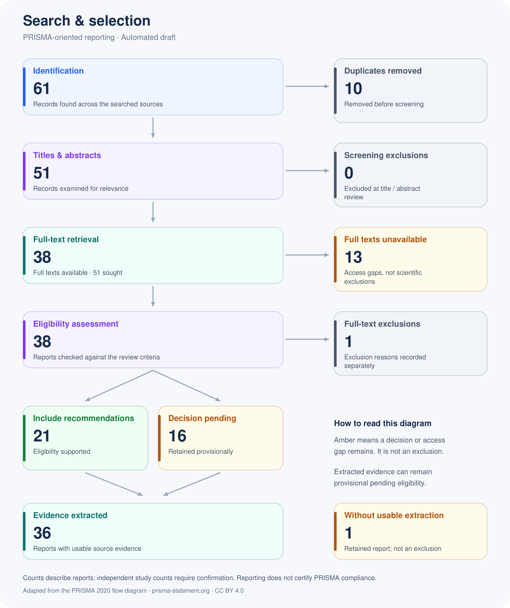

# Explainable AI in IDS SOCs: a systematic review draft

*AI-assisted manuscript. Final scientific review by the authors is pending.*

## Abstract

**Objective:** To address the research question: Which explainable AI techniques have been applied to intrusion detection systems, how have they been evaluated in laboratory or operational settings, and what evidence and gaps concern their use in Security Operations Centers?

**Methods:** Literature searches covered openalex, pubmed, arxiv (2022-01-01 to 2025-12-31). Records were deduplicated, screened against prespecified criteria and assessed in full text. Findings were synthesised narratively; no meta-analysis was performed.

**Results:** 61 records were identified, 38 full texts were retrieved, and 21 reports contributed to the primary synthesis. 16 reports remained provisional and were not used for primary conclusions.

**Scientific findings:** This review examines explainable artificial intelligence approaches applied to intrusion detection systems and their relevance to Security Operations Centers. The selected evidence describes feature-selection analysis, SHAP-based explanations, and retrieval-augmented explanation generation. One study analyzed feature selection on CICIDS-2017 and RoEduNet-SIMARGL2021. Another describes resampling to address class imbalance and SHAP force plots for interpreting model features. CyberRAG reports higher explanation ratings than the alternatives assessed in its evaluation, alongside results for adversarial examples. A separate cross-dataset evaluation of network intrusion detection models reports that none of the considered models generalized effectively across all evaluated datasets. These selected findings illustrate different explanation and evaluation approaches for intrusion detection, with results reported for particular datasets and experimental conditions. Each finding remains associated with its source publication; the cross-dataset result concerns the evaluated detection models and does not establish a universal limitation of all XAI methods. [30; PDF p. 9] [28; PDF p. 10, 16] [12; PDF p. 12, 13] [32; PDF p. 1]

**Conclusions:** The findings are specific to the evaluation settings of the included reports. No pooled estimate or overall effectiveness ranking was established.

## Introduction

Arreche et al. (2024) address the feature selection problem for intrusion detection systems by proposing new eXplainable AI methods to identify critical attributes. The study implements a Python toolkit designed to explain complex TensorFlow-based neural network models used in this task. [30; PDF p. 1, 6]

Zeng et al. propose CSAGC-IDS to address intrusion detection challenges involving high-dimensional, complex, and imbalanced data conditions. The model employs SC-CGAN for data generation and CSCA-CNN for feature extraction using cost-sensitive learning on the NSL-KDD dataset. [28; PDF p. 1, 2]

Blefari et al. (2025) present CyberRAG, a modular agent-based framework designed for cyber-attack classification and reporting. The system employs a central LLM agent to orchestrate fine-tuned classifiers, tool adapters, and an iterative retrieval-and-reason loop that queries a domain-specific knowledge base until evidence is relevant and self-consistent. [12; PDF p. 1]

Layeghy et al. investigated the generalisability of machine learning-based network intrusion detection systems by evaluating seven supervised and unsupervised models on four benchmark datasets. The study found that none of the considered models could generalise across all studied datasets, with performance significantly changing when source and target domains were swapped. [32; PDF p. 1]

Mia et al. (2024) aim to identify false positive and false negative instances in ML-based intrusion detection systems using a visual analysis approach. The study maps local SHAP feature explanation bar plots with true/false positive/negative group-wise explanations to generate overlapping plots for diagnosis. [35; PDF p. 8]

CyberDetect-MLP proposes a scalable deep learning framework for IoT cyberattack detection using Apache Spark preprocessing and a multi-layer perceptron. The study addresses limitations of traditional intrusion detection systems regarding scalability and interpretability in large-scale IoT applications. [25; PDF p. 1]

The study "Why Should I Trust Your IDS?" addresses the lack of trust in deep learning intrusion detection systems for Internet of Things networks by implementing an explainable framework using Pytorch and SHAP libraries. Its primary objective is to answer why users should trust these models through effective decision explanations. [16; PDF p. 5, 7]

Gaspar et al. (2024) applied LIME and SHAP to a Multi-Layer Perceptron for intrusion detection, aiming to validate these explanations through perturbation analysis. The study observed that certain system calls appear exclusively in false negative or false positive case explanations, suggesting they may mislead model classification. [14; PDF p. 3, 8]

Mohale et al. (2025) conducted a systematic review to evaluate explainable AI techniques for intrusion detection systems, screening studies against specific inclusion and exclusion criteria to reduce the pool to 35 articles. The study identifies SHAP and LIME as model-agnostic methods that enhance transparency in neural network-based IDS but notes limitations regarding computational efficiency and real-time deployment challenges. [9; PDF p. 1, 6, 9]

Kalakoti et al. (2025) evaluated four XAI methods—LIME, SHAP, Integrated Gradients, and DeepLIFT—to explain a Long Short-Term Memory model used for prioritizing Network Intrusion Detection System alerts in a real-world Security Operations Center setting. The study assessed these techniques using a framework measuring faithfulness, complexity, robustness, and reliability against specific alert types such as low-priority threats or false positives. [6; PDF p. 1, 4]

Mohale et al. (2025) developed an interpretable machine learning-based intrusion detection system to address the trade-off between detection performance and model explainability using the UNSW-NB15 dataset. The study integrated XAI techniques such as LIME, SHAP, and ELI5 with multiple models including Decision Trees and XGBoost to enhance transparency while identifying critical features for distinguishing normal from malicious traffic. [17; PDF p. 1, 2]

The XAI-XGBoost study developed an explainable intrusion detection framework for Internet of Medical Things systems to address class imbalance and ensure model transparency. It employed hybrid random sampling, Recursive Feature Elimination, and an optimized XGBoost classifier evaluated on the WUSTL-EHMS-2020 dataset. [18; PDF p. 1, 2]

Alsayfi et al. (2025) developed an interpretable machine learning framework for anomaly detection in intrusion detection systems using XAI techniques. The study employed Decision Trees and Random Forests trained on the public NSL-KDD dataset to address the black box nature of complex models. [11; PDF p. 1, 3]

The objective of this review is to address: Which explainable AI techniques have been applied to intrusion detection systems, how have they been evaluated in laboratory or operational settings, and what evidence and gaps concern their use in Security Operations Centers?

## Methods

### Eligibility criteria

Inclusion criteria:

- The publication applies, evaluates, or systematically reviews explainable or interpretable AI methods for intrusion detection systems.
- The publication reports empirical findings or a systematic synthesis of studies, in laboratory datasets or operational environments.
- The article body is written in English.

Exclusion criteria:

- The evaluated application concerns only tasks other than intrusion detection.
- Explainable or interpretable AI is mentioned only as background or future work, without application, evaluation, or systematic analysis for intrusion detection.

### Information sources and search strategy

Searches covered openalex, pubmed, arxiv. The publication date range was 2022-01-01 to 2025-12-31. Retrieval was capped at 10 records per query. Exact queries and execution dates are provided in the accompanying technical and reproducibility report.

### Selection and data collection

Selection and extraction were AI-assisted. Title/abstract screening used two blinded prompt roles of the same model, followed by full-text assessment; these are not independent human reviews. Eligibility criteria were applied before primary synthesis. Reports with unresolved eligibility were kept separate. Unavailable full texts were recorded as access gaps rather than scientific exclusions. Source citations and PDF page references were retained.

### Appraisal and synthesis

No formal risk-of-bias or certainty-of-evidence grading was completed. Group source-verified findings by XAI technique, IDS task, dataset, evaluation design and outcome. Compare detection performance, explanation quality and analyst outcomes when reported; do not require all outcomes. Distinguish laboratory evidence from operational SOC evidence. Discuss SOC relevance as an inference when not directly evaluated, identify transfer gaps, and do not pool incompatible metrics. Results were interpreted within each study's evaluation setting. No pooled effect was calculated.

## Results

### Study selection

The search identified 61 records. After deduplication, 51 unique records remained. Of 38 retrieved full texts, 21 reports entered the primary synthesis. Figure 1 summarises selection.

*Figure 1. Flow of record identification, screening and full-text selection.* Access failures, exclusions and unresolved eligibility are shown separately. Adapted from the PRISMA 2020 flow diagram.

### Study characteristics

The characteristics and evaluation methods of included reports are summarised in Table 1.

**Table 1. Characteristics and evaluation methods of the included reports.**

| Study | Research objective | Methods and evaluation context |
| --- | --- | --- |
| Onyilo et al. (2025) [2] | NR | The PRISMA flow diagram summarizes the following: • Identified 312 records. • Screened 154 times. • 79 records were removed due to duplicates or unnecessary information. • The final review has 75 items. (PDF p. 12) |
| Javeed et al. (2023) [3] | NR | The proposed IDS is designed by combining bidirectional long short-term memory networks (BiLSTM), a bidirectional- gated recurrent unit (Bi-GRU), fully connected layers and a softmax classifier to enhance the intrusion detection process in Industry 5.0. (PDF p. 1) |
| Kalakoti et al. (2025) [6] | This study highlights the critical need for explainable artificial intelligence (XAI) in NIDS alert classification to improve trust and interpretability. (PDF p. 1) | We employed a real-world NIDS alert dataset from Security Operations Center (SOC) of TalTech (Tallinn University Of Technology) in Estonia, developing a Long Short-Term Memory (LSTM) model to prioritize alerts. (PDF p. 1) |
| Mohale et al. (2025) [9] | This paper presents a systematic review of the integration of XAI in IDS, focusing on enhancing transparency and interpretability in cybersecurity. (PDF p. 1) | This screening process involved evaluating each study against the inclusion and exclusion criteria, reducing the pool to 35 articles. (PDF p. 6) |
| Alsayfi et al. (2025) [11] | based explanations reveal the rationale behind adversarial predictions, thereby aiding security analysts in interpreting alerts with clear, understandable justifications. (PDF p. 3) | Our framework employs Decision Trees and Random Forests, developing explainable classifiers trained on the public NSL-KDD dataset. (PDF p. 1) |
| Blefari et al. (2025) [12] | We present CyberRAG, a modular agent-based RAG framework that delivers real-time classification, explanation, and structured reporting for cyber-attacks. (PDF p. 1) | A central LLM agent orchestrates: (i) fine-tuned classi- fiers specialized by attack family; (ii) tool adapters for enrichment and alerting; and (iii) an iterative retrieval-and-reason loop that queries a domain-specific knowledge base until evidence is relevant and self-consistent. (PDF p. 1) |
| Gaspar et al. (2024) [14] | In this work, we went further and address it; we explored the explanations provided by LIME [12] and SHAP [13] through evaluation and validation analysis. (PDF p. 3) | the black box model and observe the changes in the output. (PDF p. 6) |
| Houda et al. (2022) [16] | This work aims to effec- tively explain the decision made by this DL-based IDS, the objective is, through these explanations, to answer this question: “Why should I trust your IDS?”. (PDF p. 5) | The emphasis is on exploring linear and non-linear techniques, including both local and global explanations; it consists of three tech- niques, namely, RuleFit, Local Interpretable Model-agnostic Explanations (LIME), and SHapley Additive exPlanations (SHAP). 1) RULEFIT The RuleFit algorithm was originally designed by Friedman and Popescu [30] to learn sparse linear forms (i.e., models) that contain the… (PDF p. 5) |
| Mohale et al. (2025) [17] | 1.1 Research objective and questions The primary objective of this study is to develop an effective and interpretable ML-based IDS by integrating XAI techniques, thereby addressing the trade-off between detection performance and model explainability. (PDF p. 2) | e 2 below summarises recent works related to ML-based IDS integrated with XAI, highlighting their methodologies, datasets used, key findings, and how the current study differs or advances the field. 3 Materials and methods This study employs a comprehensive methodology to develop enhanced Intrusion Detection Systems (IDS) by integrating data collection, preprocessing, modelling, and evaluation within a unified… (PDF p. 6) |
| Dakhil et al. (2025) [18] | This study aims to develop an innovative, explainable IDS framework tailored for IoMT systems that ensures both high detection accuracy and model transparency. (PDF p. 1) | Explainable AI techniques, namely SHAP and LIME, are employed to provide global and local insights into model predictions, enhancing interpretability and trustworthiness. (PDF p. 1) |
| Mazroa et al. (2025) [21] | NR | We present FORT-IDS, a Federated, Optimized, Robust and Trustworthy multi phase framework that unifies cross domain assessment, adversarial hardening and explainable artificial intelligence within a single adaptive pipeline. (PDF p. 2) |
| Almadhor et al. (2025) [23] | NR | Dataset collection and preprocessing This study leverages the publicly available NF-BoT-IoT-V2 dataset39, a comprehensive and modern network flow dataset designed for research on Internet-of-Things (IoT) security and cyberattack detection. (PDF p. 5) |
| Upender et al. (2025) [25] | In this paper, we propose CyberDetect-MLP, a scalable, explainable, big data-enabled, and optimized deep learning framework for IoT cyberattack detection, addressing these challenges. (PDF p. 1) | NR |
| Sharma et al. (2025) [26] | NR | NR |
| Satpathy et al. (2025) [27] | NR | Specifically, the study investigates three actor-critic DRL algorithms: Twin Delayed Deep Deterministic Policy Gradient (TD3), Deep Deterministic Policy Gradient (DDPG), and Advantage Actor-Critic (A2C) to differentiate between benign and malicious network traffic. (PDF p. 1) |
| Zeng et al. (2025) [28] | Therefore, further research is needed to enhance the performance of NIDMs in detecting rare attacks under high-dimensional, complex, and imbal- anced data conditions. 1.2 Research Content and Contributions In response to the challenge of analyzing high-dimensional, intricate, and imbal- anced intrusion traffic data, CSAGC-IDS intrusion detection model is proposed. (PDF p. 2) | NR |
| Arreche et al. (2024) [30] | In this work, we tackle the feature selection problem for IDS by suggesting new ways of applying eXplainable AI (XAI) methods for this problem. (PDF p. 1) | It can be described as a Python feature selection toolkit package that fo- cuses on explaining complex TensorFlow-based neural network models. (PDF p. 6) |
| Kumar et al. (2024) [31] | NR | In this work, we analyze state-of-the-art DL-based NIDS models using conventional as well as recently proposed XAI techniques through extensive experiments with different attack datasets. (PDF p. 1) |
| Layeghy et al. (2022) [32] | In this paper, we investigate the generalisability property of ML-based NIDSs by extensively evaluating seven supervised and unsupervised learning models on four recently published benchmark NIDS datasets. (PDF p. 1) | Our work aims to address this gap by taking advantage of four recently published NIDS benchmark datasets [12], which have been converted from their original format into a common NetFlow-based format, with an identical feature set. (PDF p. 1) |
| Muhammad et al. (2025) [33] | NR | NR |
| Mia et al. (2024) [35] | identify false positive and false negative through a more ef- fective visual analysis approach. (PDF p. 8) | Our approach maps the local SHAP based feature explanation bar plots with the TP, FP, TN, FN group-wise explanation bar plots to generate a overlapping bar plot and find potential similarities and dissimilarities to correctly identify false positive and false negative instances. (PDF p. 8) |

*Note.* Cells reproduce source-reported information cited in the manuscript. NR = not reported in the available cited evidence. An ellipsis indicates a shortened excerpt; PDF pages refer to the source article.

### Findings

The study XAI-based Feature Selection for Improved Network Intrusion Detection Systems (Arreche et al., 2024) analyzes performance metrics including accuracy and F1 score for the CICIDS-2017 dataset using a Python feature selection toolkit. This tool employs back-propagation to determine class derivatives within complex TensorFlow-based neural network models. [30; PDF p. 6, 9]

Zeng et al. (2025) applied SHAP to CSAGC-IDS for intrusion detection on the KDDTrain+ dataset, generating balanced samples to match the Normal class count of 67,343. The study visualized Shapley values in force plots, showing service_http positively and flag_REJ negatively affecting attack predictions. [28; PDF p. 10, 16]

CyberRAG employs a central LLM agent to orchestrate fine-tuned classifiers, tool adapters, and an iterative retrieval-and-reason loop. Explanations generated by this system consistently score higher across all models, with LLaMA3.1:8B reaching a mean rating of 4.9. [12; PDF p. 1, 12]

Siamak Layeghy et al. (2022) investigated machine learning-based network intrusion detection systems, finding that none generalise well across all studied datasets. Their results indicate unsupervised models generalise better than supervised ones, though single-domain performance remains lower. [32; PDF p. 1, 10]

The L-XAIDS framework evaluated classification performance on UNSW-NB15, CSE-CIC-IDS2018, and LITNET-2020 datasets using Weighted Avg Recall of 0.843, 0.823, and 0.800 respectively. Decision Trees generated visualizations depicting significant attributes in descending order to enhance prediction transparency. [33; PDF p. 32, 41]

Kumar et al. (2024) evaluated TRUSTEE on the Mirai dataset using a Decision Tree explanation against the HorusEye model. With 30% of samples and no pruning, this approach achieved negative fidelity (∼−1.365), indicating the tree fit predictions worse than the mean. Even with top-k pruning (k=10), fidelity remained near zero (∼−1.038e−06). Conversely, comparing against ENIDrift yielded a positive fidelity of 0.715. [31; PDF p. 9, 10]

Maraz Mia et al. (2024) applied SHAP-based feature explanation to an XGBoost model for intrusion detection using datasets D1 through D3. The study split data into 80:20 train and test portions, achieving 99.68% accuracy on D1 with the XGB model. Overlapping bar plots mapped local SHAP explanations to true/false positive/negative groups to diagnose misclassifications. [35; PDF p. 4, 8]

The proposed model in Satpathy et al. (2025) applied hybrid feature selection with TD3 to detect DDoS attacks on the CICDDoS2019 and UNSW NB-15 datasets, achieving 99.12% accuracy. However, the study notes that while generalization is strong, real-time latency assessment remains a necessary limitation for practical deployment. [27; PDF p. 11]

Sharma et al. (2025) evaluated a self-attention-based explainable AI framework for intrusion detection using the FORT-IDS dataset. The proposed SA-DNN + LFG model achieved an accuracy of 99.6% ± 0.1 and an F1-score of 99.5% ± 0.11 on normal traffic, while maintaining 97.9% ± 0.3 accuracy and 97.5% ± 0.21 F1-score under specific conditions. [26; PDF p. 26]

The CyberDetect-MLP model achieved an accuracy of 98.87% on the TON_IoT dataset using Grad-CAM for explainability. Visual analysis corroborated these statistical results, validating the proposed framework's reliability. [25; PDF p. 19, 22]

The study [23] evaluated its proposed ANN and CNN architectures on the NF-BoT-IoT-V2 dataset using five intrusion categories. The ANN model achieved a weighted accuracy of 98% across these classes, with consistent training and validation metrics suggesting low overfitting. [23; PDF p. 6]

Zakaria Abou El Houda et al. (2022) implemented an XAI framework using Pytorch and SHAP to enhance interpretability in their IoT intrusion detection system against well-known attacks. The study applied three techniques, including RuleFit, LIME, and SHAP, to help cybersecurity experts understand IDS decisions. [16; PDF p. 3, 5, 7]

The proposed IDS combines BiLSTM, Bi-GRU, fully connected layers, and a softmax classifier to enhance intrusion detection in Industry 5.0. It employs the SHapley Additive exPlanations mechanism to interpret decisions made by this deep learning model. The study evaluates performance on the CICDDoS2019 IoT-based dataset, achieving macro and micro-average scores of 0.99 and 1.00 respectively. [3; PDF p. 1, 2, 5, 8]

Diogo Gaspar et al. (2024) applied LIME and SHAP to a Multi-Layer Perceptron for intrusion detection using system calls as features. The study observed that replacing the ten most important system calls with those appearing only in false negative cases significantly altered model outputs, such as shifting false positive instances to true negatives when substituting critical calls with nfsservctl. [14; PDF p. 8, 9, 10]

Mohale et al. (2025) found that XAI techniques like SHAP and LIME enhance transparency in intrusion detection systems by reducing false-positive rates and improving analyst trust. Model-agnostic explanations allow analysts to understand factors influencing threat classification decisions in neural network-based IDS. [9; PDF p. 7, 9]

Kalakoti et al. (2025) evaluated DeepLIFT on the FORT-IDS dataset using Faithfulness and sensitivity metrics. The study reported a mean Faithfulness correlation of 0.7559 ± 0.2681 for test data points, with entropy values more evenly spread toward lower ends compared to other explainers. [6; PDF p. 11]

Mohale et al. (2025) evaluated machine learning-based intrusion detection systems using a dataset containing ten attack types including Fuzzers and Worms. The study reported an overall accuracy of 86.87% and noted that CatBoost and Decision Tree classifiers achieved the highest accuracy of 87%. [17; PDF p. 12, 15]

The proposed XAI-XGBoost model achieved 99.22% accuracy in distinguishing normal from attack traffic within Internet of Medical Things environments. For benign Class 0 traffic, the study reported a precision of 100% and recall of 99% to minimize false positives. [18; PDF p. 11]

The study by Onyilo et al. (2025) evaluated intrusion detection systems using NSL-KDD, UNSW-NB15, and CICIDS2017 datasets with metrics including accuracy, precision, recall, F1-score, and ROC-AUC. Results showed the hybrid architecture achieved 98.4% accuracy on CICIDS2017, outperforming baseline models like Random Forest (94.5%) and SVM (92.7%). The authors conclude that explainable models are key to responsible cybersecurity systems. [2; PDF p. 13]

Alsayfi et al. (2025) evaluated Random Forest and Decision Tree classifiers for intrusion detection on the NSL-KDD dataset using a Wilcoxon signed-rank test to confirm Random Forest's statistically significant performance advantage over Decision Trees across cross-validation folds. Both models demonstrated high AUC values, indicating strong ability to distinguish between attack and normal classes while identifying key features like protocol type and packet counts as major decision factors. [11; PDF p. 3, 13]

The FORT-IDS model evaluated intrusion detection on the DDoS dataset using a Graph Neural Network, achieving a macro F1 score of 0.976 ± 0.005 (±0.010). On the UNSW dataset, the same model recorded a macro F1 score of 0.889 ± 0.011 (±0.023) with a Graph Neural Network architecture. [21; PDF p. 18]

Principal reported findings and their evaluation context are presented in Table 2.

**Table 2. Principal findings reported in the included studies.**

| Study | Reported outcome and evaluation context |
| --- | --- |
| Onyilo et al. (2025) [2] | The study adds to both the academic theory and the practical defense systems by showing that accuracy and efficiency can be achieved with interpretability. (PDF p. 16) |
| Javeed et al. (2023) [3] | Moreover, the proposed model achieved macro and micro-average of 0.99 and 1.00 respectively. (PDF p. 5) |
| Kalakoti et al. (2025) [6] | Deep Lift achieved the highest Faithfulness mean and standard deviation correlation values of 0.7559 ± 0.2681 for test data points. (PDF p. 11) |
| Mohale et al. (2025) [9] | The findings indicate that various XAI techniques, such as SHAP, LIME, and hybrid models, provide significant benefits for IDS, including enhanced transparency, reduced false-positive rates, and improved analyst trust in model outputs. (PDF p. 9) |
| Alsayfi et al. (2025) [11] | The statistical significance (p < 0.05) of RF's higher performance over DT across cross-validation folds was confirmed by a Wilcoxon signed-rank test. (PDF p. 13) |
| Blefari et al. (2025) [12] | As seen in Figure 4, explanations produced with RAG consis- tently score higher across all models, with LLaMA3.1:8B reach- ing the highest mean rating of 4.9. (PDF p. 12) |
| Gaspar et al. (2024) [14] | On a global analysis, it was possible to observe that there are system calls that only appear, for example, in the explanations of FN cases and not in the explanations of TP cases (and vice versa). (PDF p. 8) |
| Houda et al. (2022) [16] | The experimental results show the efficiency of our frame- work to improve the interpretability of the IoT IDS against well-known IoT attacks, and help the cybersecurity experts get a better understanding of IDSs’ decisions. (PDF p. 3) |
| Mohale et al. (2025) [17] | This dataset contained 10 types of attacks: Fuzzers, Analysis, Backdoors, DoS, Exploits, Generic, Reconnaissance, Shellcode, Normal attacks and Worms. (PDF p. 12) |
| Dakhil et al. (2025) [18] | Classification results As summarized in Table 4, the proposed IDS model demonstrated outstanding classification performance, achieving an overall accuracy of 99.22%, confirming its capability to reliably distinguish between normal and attack traffic in IoMT environments. (PDF p. 11) |
| Mazroa et al. (2025) [21] | NR |
| Almadhor et al. (2025) [23] | Experimental analysis and results Classification results To assess the effectiveness of our proposed ANN and CNN architectures on the NF-BoT-IoT-V2 dataset, we evaluated classification performance across five categories: Benign, DoS, DDoS, Theft, and Reconnaissance, as shown in Table 1. (PDF p. 6) |
| Upender et al. (2025) [25] | The visual analysis corroborates the statistical results reported in Table 4, validating the robustness and reliability of the proposed model. (PDF p. 19) |
| Sharma et al. (2025) [26] | NR |
| Satpathy et al. (2025) [27] | NR |
| Zeng et al. (2025) [28] | In the case of the KDDTrain+ dataset, since the Normal class originally contained the highest number of samples at 67,343, I generated an equivalent number of samples for each other category to match this figure. (PDF p. 10) |
| Arreche et al. (2024) [30] | All performance metrics (Acc, Prec, F1, MCC, Bacc, and AucRoc) for the CICIDS-2017 and RoEduNet- SIMARGL2021 datasets are analyzed. (PDF p. 9) |
| Kumar et al. (2024) [31] | Using TRUSTEE with 30% of the Mirai dataset samples with no pruning results in a DT expla- nation which achieves negative fidelity (∼−1.365) compared to original HorusEye model. (PDF p. 9) |
| Layeghy et al. (2022) [32] | Our investigation indicates that none of the considered models is able to generalise over all studied datasets. (PDF p. 1) |
| Muhammad et al. (2025) [33] | Weighted Avg Recall 0.843 0.823 0.800 F1-score Metrics Avg F1-score 0.842 0.820 0.785 Macro Avg F1-score 0.837 0.803 0.767 Weighted Avg F1-score 0.857 0.823 0.810 Overall Accuracy 0.85 0.83 0.81 Table 4 presents a comprehensive evaluation of the L-XAIDS framework’s classifi- cation performance across three different datasets: UNSW-NB15, CSE-CIC-IDS2018, and LITNET-2020. (PDF p. 41) |
| Mia et al. (2024) [35] | It is evident that XGBoost model outperformed the other mod- els for all the datasets in terms of standard performance metrics as well as the lower value of Brier score. (PDF p. 4) |

*Note.* Values, units and confidence intervals are retained as reported. Outcomes from different evaluation settings are not head-to-head comparisons. No pooled estimate is presented.

**Table 3. Numerical outcomes reported by Dakhil et al. (2025) [18].**

| Models | Accuracy | Precision | Recall | F1-Score |
| --- | --- | --- | --- | --- |
| The proposed model | 99.22 | 98.35 | 99.91 | 99.12 |

*Note.* Source column headings and units are retained without conversion. Only numerical rows cited by the verified manuscript are reproduced. Source: [18], PDF p. 12.

**Table 4. Numerical outcomes reported by Mazroa et al. (2025) [21].**

| Model | Dataset | Macro Precision | Macro Recall | Macro F1 |
| --- | --- | --- | --- | --- |
| GNN | DDoS | 0.978 ± 0.006 (±0.012) | 0.975 ± 0.005 (±0.010) | 0.976 ± 0.005 (±0.010) |
| GNN | UNSW | 0.891 ± 0.011 (±0.022) | 0.888 ± 0.012 (±0.024) | 0.889 ± 0.011 (±0.023) |

*Note.* Source column headings and units are retained without conversion. Only numerical rows cited by the verified manuscript are reproduced. Source: [21], PDF p. 18.

**Table 5. Numerical outcomes reported by Upender et al. (2025) [25].**

| Model/study | Approach | Dataset | Accuracy (%) | Scalability E | Explainability |
| --- | --- | --- | --- | --- | --- |
| Proposed CyberDetect-MLP | Optimized MLP | TON_IoT (full) | 98.87 | High H | High (Grad-CAM) |

*Note.* Source column headings and units are retained without conversion. Only numerical rows cited by the verified manuscript are reproduced. Source: [25], PDF p. 22.

**Table 6. Numerical outcomes reported by Sharma et al. (2025) [26].**

| Class | Model | Accuracy (%) | Precision (%) | Recall (%) | F1-measure (%) |
| --- | --- | --- | --- | --- | --- |
| Normal | SA-DNN | 98.6 ± 0.3 | 97 ± 0.4 | 98.2 ± 0.3 | 97.6 ± 0.25 |

*Note.* Source column headings and units are retained without conversion. Only numerical rows cited by the verified manuscript are reproduced. Source: [26], PDF p. 13.

**Table 7. Numerical outcomes reported by Sharma et al. (2025) [26].**

| Model | Accuracy (%) | Precision (%) | Recall (%) | F1-Score (%) |
| --- | --- | --- | --- | --- |
| Proposed SA-DNN + LFG | 99.6 ± 0.1 | 99.4 ± 0.2 | 99.7 ± 0.1 | 99.5 ± 0.11 |

*Note.* Source column headings and units are retained without conversion. Only numerical rows cited by the verified manuscript are reproduced. Source: [26], PDF p. 26.

**Table 8. Numerical outcomes reported by Sharma et al. (2025) [26].**

| Model | Accuracy (%) | Precision (%) | Recall (%) | F1-score (%) |
| --- | --- | --- | --- | --- |
| Proposed SA-DNN + LFG | 97.9 ± 0.3 | 97.2 ± 0.3 | 97.7 ± 0.3 | 97.5 ± 0.21 |

*Note.* Source column headings and units are retained without conversion. Only numerical rows cited by the verified manuscript are reproduced. Source: [26], PDF p. 26.

**Table 9. Numerical outcomes reported by Satpathy et al. (2025) [27].**

| Author | Method | Dataset | Accuracy (%) | Limitations |
| --- | --- | --- | --- | --- |
| Proposed Model | Hybrid Feature Selection + TD3 (DRL-based Detection) | CICDDoS2019 + UNSW NB-15 | 99.12 | Strong generalization; needs real-time latency assessment |

*Note.* Source column headings and units are retained without conversion. Only numerical rows cited by the verified manuscript are reproduced. Source: [27], PDF p. 11.

## Discussion

Arreche et al. (2024) developed a Python toolkit to explain complex TensorFlow models for network intrusion detection using back-propagation-based maps. The study analyzed performance metrics on CICIDS-2017 and RoEduNet-SIMARGL2021 datasets while noting that the Destination Port feature may introduce bias into AI networks. [30; PDF p. 6, 9, 19]

CyberRAG employs a central LLM agent to orchestrate fine-tuned classifiers, tool adapters, and an iterative retrieval-and-reason loop for cyber attack classification. However, the study notes that CyberRAG's effectiveness depends on the preceding IDS/IPS performance and its inability to recognize unseen attack types. [12; PDF p. 1, 14]

Layeghy et al. (2022) evaluated machine learning models for network intrusion detection using four NetFlow-based benchmark datasets converted to a common feature set. The study assessed generalisability by training each model on one dataset and testing it against the other three without further training, covering both supervised and unsupervised approaches. [32; PDF p. 1, 4]

Kumar et al. (2024) evaluated Deep Learning-based Network Intrusion Detection Systems using XAI techniques like TRUSTEE and SHAP against attack datasets including Mirai. The study applied a specific criterion to measure agreement between global and local explanations for these NIDS models. [31; PDF p. 1, 9]

Maraz Mia et al. (2024) evaluated SHAP plots for diagnosing misclassifications in binary intrusion detection using a case study of true and false positives. The authors explicitly noted that their work did not incorporate deep learning models, multi-class scenarios, adversarial attacks, or frequent model retraining to address concept drift. [35; PDF p. 8]

Satpathy et al. (2025) evaluated Deep Reinforcement Learning algorithms, including TD3, DDPG, and A2C, for distinguishing benign from malicious network traffic using the CICDDoS2019 and UNSW-NB15 datasets. The study employed a hybrid feature selection strategy combining Boruta, SHAP, and cross-validation stability analysis to ensure interpretability. However, the authors note that these benchmark datasets cannot fully replicate the complexity of real-world cloud traffic. [27; PDF p. 1, 11]

Almadhor et al. (2025) evaluated a neuro-symbolic dual-model architecture for intrusion detection using the NF-BoT-IoT-V2 dataset, which was preprocessed by removing timestamps and device addresses while handling missing values via forward filling. The study aggregated feature maps through Adaptive Average Pooling to support its explainable analysis. [23; PDF p. 5]

The FORT-IDS framework integrates explainable AI using SHAP and LIME to identify unstable features within its five-stage pipeline. This study applies these techniques to reveal attributions that vary across sites or time, aiming to reduce drift through lightweight mapping and normalization. [21; PDF p. 2]

Javeed et al. (2023) developed an explainable intrusion detection system for Industry 5.0 using bidirectional LSTM, Bi-GRU, fully connected layers, and a softmax classifier implemented in TensorFlow. The study employed the SHapley Additive exPlanations mechanism to interpret decisions made by this deep learning model. [3; PDF p. 1, 2, 5]

The study by Diogo Gaspar et al. (2024) evaluates LIME and SHAP on a multi-layer perceptron for intrusion detection using perturbation analysis. The authors replace feature appearances in the dataset to observe output changes, thereby validating explanations generated by these models. [14; PDF p. 5, 6]

Kalakoti et al. (2025) evaluated four XAI methods—LIME, SHAP, Integrated Gradients, and DeepLIFT—on a real-world NIDS alert dataset from the TalTech SOC to prioritize alerts. The study assessed these techniques using a framework measuring faithfulness, complexity, robustness, and reliability. [6; PDF p. 1]

Mohale et al. (2025) developed machine learning intrusion detection systems using models such as CatBoost and XGBoost, employing SHAP to explain feature contributions toward classification output. The study evaluated these methods within a unified framework that integrated data collection, preprocessing, modelling, and assessment. [17; PDF p. 6, 15]

The study proposes an XGBoost classifier for intrusion detection in Internet of Medical Things systems using the WUSTL-EHMS-2020 dataset. It employs SHAP and LIME to provide global and local insights into model predictions, enhancing interpretability. [18; PDF p. 1, 2]

Alsayfi et al. (2025) applied SHAP and LIME to Decision Trees and Random Forests for intrusion detection using the NSL-KDD dataset. The study refined preprocessing with normalization and one-hot encoding while limiting tree depth to prevent overfitting in single-tree models. [11; PDF p. 1, 11]

Onyilo et al. (2025) conducted a systematic review of explainable AI in intrusion detection systems, identifying 75 final items from 312 initial records via PRISMA guidelines. The study concludes that accuracy and efficiency can be achieved with interpretability in cybersecurity defense systems. [2; PDF p. 12, 16]

### Interpretation across studies

The findings are interpreted within the evaluation settings of the included reports. Numerical differences between studies do not, by themselves, establish comparative superiority. The evidence presented here does not provide a pooled estimate or an overall ranking of approaches.

## Limitations

### Limitations reported in the included studies

Mohale et al. (2025) [9] reported the following study limitation: “However, these methods have limitations, especially regarding computational efficiency and real-time deployment challenges (Barredo et al., 2020; Adadi and Berrada, 2018).” [9; PDF p. 9]

Alsayfi et al. (2025) [11] reported the following study limitation: “The DT classifier is fit by a best-fitting tree depth to maintain manageable complexity and prevent overfitting too much and is a drawback of single-tree models [32].” [11; PDF p. 11]

Blefari et al. (2025) [12] reported the following study limitation: “One of the main limitations of this approach is its dependence on the quality of the data within the knowledge base and the pre- cision of the classifier.” [12; PDF p. 14]

Satpathy et al. (2025) [27] reported the following study limitation: “The experiments were conducted on benchmark datasets (CICDDoS2019 and UNSW- NB15) that, although comprehensive, cannot fully replicate the complexity and evolving nature of real-world cloud traffic.” [27; PDF p. 11]

Arreche et al. (2024) [30] reported the following study limitation: “In par- ticular, it has been noted that the feature “Destination Port” may be biased [24] and that adding it to AI net- work intrusion detection models might have contami- nating consequences.” [30; PDF p. 19]

Mia et al. (2024) [35] reported the following study limitation: “Limitations: First, we have not considered deep learning models in this study as our primary focus have been more on the model explainability and transparency for decision- making.” [35; PDF p. 8]

### Limitations of this review

The synthesis is based on 21 included reports. Its coverage is bounded by the searched sources and the retrieval limit of 10 records per query; it should not be interpreted as an exhaustive account of the literature.

The interpretation is restricted to the populations, datasets, outcome definitions and evaluation settings reported in the included evidence. No pooled effect or general effectiveness ranking was established.

Full texts were unavailable for 13 sought reports, which may affect the coverage of the synthesis.

Eligibility remained unresolved for 16 reports; these were not used to support the primary conclusions.

A formal risk-of-bias assessment and certainty-of-evidence grading were not completed; the strength of the conclusions must be interpreted accordingly.

## Conclusion

Arreche et al. (2024) analyzed performance metrics for the CICIDS-2017 and RoEduNet-SIMARGL2021 datasets to evaluate explainable AI techniques in network intrusion detection systems. The study noted that adding the feature 'Destination Port' might have contaminating consequences due to potential bias. [30; PDF p. 9, 19]

Zeng et al. (2025) applied SHAP to the CSAGC-IDS model for intrusion detection on the KDDTrain+ dataset, generating balanced samples to address class imbalance. The study visualized Shapley values via force plots to interpret attack predictions, identifying service_http as a positive predictor and flag_REJ as a negative predictor. [28; PDF p. 10, 16]

CyberRAG (Blefari et al., 2025) evaluated RAG-based explanations for cyber attack classification, finding that LLaMA3.1:8B achieved the highest mean rating of 4.9 and correctly classified 94% of adversarial examples. However, the study noted a primary limitation regarding its dependence on knowledge base quality and classifier precision. [12; PDF p. 12, 13, 14]

Layeghy et al. (2022) investigated generalisability across multiple datasets, finding that no studied model generalises well over all data sources. Their results indicate unsupervised ML-based Network Intrusion Detection Systems generalise better than supervised counterparts, despite lower single-domain performance. [32; PDF p. 1, 10]

The L-XAIDS framework evaluated intrusion detection performance across three datasets using Weighted Avg Recall of 0.843 and an Overall Accuracy of 0.85. Decision Trees generated visualizations depicting significant attributes in descending order, where each feature value affects the accumulated prediction value. [33; PDF p. 32, 38, 41]

Sharma et al. (2025) evaluated a self-attention-based deep neural network with local feature gating for intrusion detection in IoT environments. The proposed SA-DNN + LFG model achieved an accuracy of 99.6% ± 0.1 and an F1-score of 99.5% ± 0.11 on the primary dataset, while maintaining 98.2% ± 0.3 precision for normal traffic classification. [26; PDF p. 13, 26]

Almadhor et al. (2025) evaluated their proposed ANN and CNN architectures on the NF-BoT-IoT-V2 dataset to detect five specific intrusion categories: Benign, DoS, DDoS, Theft, and Reconnaissance. The study reported a weighted accuracy of 98% for the ANN model, noting consistent metrics between training and validation phases. [23; PDF p. 6]

Abou El Houda et al. (2022) evaluated their explainable deep learning framework for intrusion detection systems in Internet of Things networks using well-known IoT attacks. The experimental results demonstrated that the framework improved interpretability and helped cybersecurity experts understand IDS decisions. [16; PDF p. 3]

The study proposed an explainable intrusion detection system evaluated on the CICDDoS2019 IoT-based dataset. The model achieved macro and micro-average scores of 0.99 and 1.00 respectively. [3; PDF p. 5, 8]

The study applied LIME and SHAP to a Multi-Layer Perceptron for intrusion detection. It demonstrated that replacing the ten most important system calls with those appearing only in false negative explanations significantly altered model outputs, such as shifting false positive instances to true negatives when nfsservctl was substituted. [14; PDF p. 8, 9, 10]

Mohale et al. (2025) report that explainable AI techniques like SHAP and LIME enhance transparency in intrusion detection systems by revealing factors influencing threat classification decisions. These methods also reduce false-positive rates, enabling analysts to better validate flagged threats despite challenges with computational efficiency. [9; PDF p. 7, 9]

Kalakoti et al. (2025) evaluated explainable AI for deep learning-based network intrusion detection system alert classification using DeepLIFT and Integrated Gradients. Their study reported that DeepLIFT achieved the highest Faithfulness mean and standard deviation correlation values of 0.7559 ± 0.2681 for test data points, indicating strong consistency through monotonicity. [6; PDF p. 11]

Mohale et al. (2025) evaluated machine learning models for intrusion detection using a dataset containing ten attack types including Fuzzers and Worms. Their analysis showed that CatBoost and Decision Tree classifiers achieved the highest accuracy of 87% in this laboratory setting. [17; PDF p. 12]

The proposed XAI-XGBoost model achieved an overall accuracy of 99.22% in distinguishing normal from attack traffic within Internet of Medical Things environments. For benign activity, it recorded perfect precision and 99% recall to minimize false positives. [18; PDF p. 11, 12]

Alsayfi et al. (2025) evaluated Random Forest and Decision Tree models for intrusion detection on the NSL-KDD dataset, confirming via Wilcoxon signed-rank test that Random Forest significantly outperformed Decision Trees across cross-validation folds. The study demonstrated that parameters such as protocol type and packet counts substantially influence IDS decisions through intensive explainable AI interpretation. [11; PDF p. 3, 13]

Onyilo et al. (2025) demonstrated that explainable AI models for intrusion detection systems achieve high accuracy and efficiency through a hybrid architecture. Their study evaluated performance using metrics such as precision, recall, and F1-score across datasets including NSL-KDD, UNSW-NB15, and CICIDS2017. [2; PDF p. 13, 16]

Taken together, these reports support conclusions confined to their respective study settings. Broader applicability and comparative effectiveness require evidence beyond the estimates summarised here.

## Declarations

### AI assistance

AI assistance was used for review preparation. The accompanying technical and reproducibility report documents the tools, generation settings, validation procedure and audit trail. This manuscript remains subject to final author verification.

Registration: Not registered. Funding: Not reported. Conflicts of interest: Not reported.

## References

- [1] Subash Neupane, Jesse Ables, William S. Anderson, Sudip Mittal, Shahram Rahimi, Ioana Banicescu, Maria A. Seale. Explainable Intrusion Detection Systems (X-IDS): A Survey of Current Methods, Challenges, and Opportunities. 2022. https://doi.org/10.1109/access.2022.3216617
- [2] James Onyilo, Victoria Chibuzo Uzuegbu. Explainable AI Intrusion Detection System: Improving Transparency and Trust in Cybersecurity. 2025. https://doi.org/10.65752/e5fa2b27
- [3] Danish Javeed, Tianhan Gao, Prabhat Kumar, Alireza Jolfaei. An Explainable and Resilient Intrusion Detection System for Industry 5.0. 2023. https://doi.org/10.1109/tce.2023.3283704
- [4] Naseem Khan, Kashif Ahmad, Aref Al Tamimi, Mohammed M. Alani, Amine Bermak, Issa M. Khalil. Explainable AI-Based Intrusion Detection Systems for Industry 5.0 and Adversarial XAI: A Systematic Review. 2025. https://doi.org/10.3390/info16121036
- [5] Siamak Parhizkari. Anomaly Detection in Intrusion Detection Systems. 2023. https://doi.org/10.5772/intechopen.112733
- [6] Rajesh Kalakoti, Risto Vaarandi, Hayretdin Bahşi, Sven Nõmm. Evaluating Explainable AI for Deep Learning-Based Network Intrusion Detection System Alert Classification. 2025. https://doi.org/10.5220/0013180700003899
- [7] Pap M. Corea, Yongxin Liu, Jian Wang, Shuteng Niu, Houbing Song. Explainable AI for Comparative Analysis of Intrusion Detection Models. 2024. https://doi.org/10.1109/meditcom61057.2024.10621339
- [8] Henry Durojaye, Mohammad Naiseh. Explainable AI for Intrusion Detection Systems: A Model Development and Experts’ Evaluation. 2024. https://doi.org/10.1007/978-3-031-66428-1_18
- [9] Vincent Zibi Mohale, Ibidun Christiana Obagbuwa. A systematic review on the integration of explainable artificial intelligence in intrusion detection systems to enhancing transparency and interpretability in cybersecurity. 2025. https://doi.org/10.3389/frai.2025.1526221
- [10] Alice Lawrence. Explainable AI Framework for Anomaly Detection in Encrypted Network Traffic. 2025. https://doi.org/10.31224/5825
- [11] Majed S. Alsayfi. INTERPRETABLE MACHINE LEARNING FRAMEWORK FOR ANOMALY DETECTION IN INTRUSION DETECTION SYSTEMS USING XAI TECHNIQUES. 2025. https://doi.org/10.12732/ijam.v38i5s.667
- [12] Francesco Blefari, Cristian Cosentino, Francesco Aurelio Pironti, Angelo Furfaro, Fabrizio Marozzo. CyberRAG: An Agentic RAG cyber attack classification and reporting tool. 2025. https://doi.org/10.1016/j.future.2025.108186
- [13] Osvaldo Arreche, Tanish R. Guntur, Jack W. Roberts, Mustafa Abdallah. E-XAI: Evaluating Black-Box Explainable AI Frameworks for Network Intrusion Detection. 2024. https://doi.org/10.1109/access.2024.3365140
- [14] Diogo Gaspar, Paulo Victor Santos Silva, Catarina Silva. Explainable AI for Intrusion Detection Systems: LIME and SHAP Applicability on Multi-Layer Perceptron. 2024. https://doi.org/10.1109/access.2024.3368377
- [15] Usman Ahmed, Zheng Jiangbin, Ahmad Almogren, Sheharyar Khan, Muhammad Tariq Sadiq, Ayman Altameem, Ateeq Ur Rehman. Explainable AI-based innovative hybrid ensemble model for intrusion detection. 2024. https://doi.org/10.1186/s13677-024-00712-x
- [16] Zakaria Abou El Houda, Bouziane Brik, Lyes Khoukhi. “Why Should I Trust Your IDS?”: An Explainable Deep Learning Framework for Intrusion Detection Systems in Internet of Things Networks. 2022. https://doi.org/10.1109/ojcoms.2022.3188750
- [17] Vincent Zibi Mohale, Ibidun Christiana Obagbuwa. Evaluating machine learning-based intrusion detection systems with explainable AI: enhancing transparency and interpretability. 2025. https://doi.org/10.3389/fcomp.2025.1520741
- [18] Yousif Hosain Dakhil, Muhammet Çakmak. XAI-XGBoost: an innovative explainable intrusion detection approach for securing internet of medical things systems. 2025. https://doi.org/10.1038/s41598-025-07790-0
- [19] Fatemeh Ebrahimi, Reza Javidan, Reza Akbari, Yasin Hosseini. Intrusion detection in the internet of things using convolutional neural networks: an explainable AI approach. 2025. https://doi.org/10.1186/s42400-025-00369-2
- [20] Sweety Ramnani, Kaushik Roy, Amit Sheth. MATRIX: Mental heAlth diagnostics Through Real time Intelligent unified X-AI attribution reasoning.. 2025. https://doi.org/10.3389/fdgth.2025.1621271
- [21] Alanoud Al Mazroa. FORT-IDS: a federated, optimized, robust and trustworthy intrusion detection system for IIoT security.. 2025. https://doi.org/10.1038/s41598-025-31025-x
- [22] N Ashwini, Srinivas Dava, A Rakesh Phanindra, Gotte Ranjith Kumar, K Varada Rajkumar, Narne Sravanthi. ThreatFedChainAI: an adaptive edge blockchain architecture for big data-driven threat analytics in IoT networks.. 2025. https://doi.org/10.1038/s41598-025-31164-1
- [23] Ahmad Almadhor, Shtwai Alsubai, Abdullah Al Hejaili, Zeineb Klai, Belgacem Bouallegue, Urban Kovac. Designing a neuro-symbolic dual-model architecture for explainable and resilient intrusion detection in IoT networks.. 2025. https://doi.org/10.1038/s41598-025-27076-9
- [24] Radwa El Shawi, Leila Jamel. AutoXAI: a meta-learning approach for recommendation of explanation techniques.. 2025. https://doi.org/10.1038/s41598-025-25872-x
- [25] Talluri Upender, M Neelakantappa, C Prakasa Rao, Jaideep Gera, Vuyyuru Lakshma Reddy, Nagendar Yamsani. CyberDetect MLP a big data enabled optimized deep learning framework for scalable cyberattack detection in IoT environments.. 2025. https://doi.org/10.1038/s41598-025-24459-w
- [26] Kanta Prasad Sharma, Tapsi Nagpal, Tarak Vora, Anupam Yadav, Muhammad Irsyad Abdullah, B Jayaprakash, Aditya Kashyap, G Sridevi, A Bhowmik, Bethelehem Burju Bukate. Interpretable intrusion detection for IoT environments using a self-attention-based explainable AI framework.. 2025. https://doi.org/10.1038/s41598-025-23750-0
- [27] Suneeta Satpathy, Uttpal Tripathy, Pratik Kumar Swain. Cloud-based DDoS detection using hybrid feature selection with deep reinforcement learning (DRL).. 2025. https://doi.org/10.1038/s41598-025-18857-3
- [28] Yifan Zeng. CSAGC-IDS: A Dual-Module Deep Learning Network Intrusion Detection Model for Complex and Imbalanced Data. 2025. http://arxiv.org/abs/2505.14027v1
- [29] Vinura Galwaduge, Jagath Samarabandu. Tabular Diffusion based Actionable Counterfactual Explanations for Network Intrusion Detection. 2025. http://arxiv.org/abs/2507.17161v1
- [30] Osvaldo Arreche, Tanish Guntur, Mustafa Abdallah. XAI-based Feature Selection for Improved Network Intrusion Detection Systems. 2024. http://arxiv.org/abs/2410.10050v1
- [31] Ayush Kumar, Vrizlynn L. L. Thing. Evaluating The Explainability of State-of-the-Art Deep Learning-based Network Intrusion Detection Systems. 2024. http://arxiv.org/abs/2408.14040v4
- [32] Siamak Layeghy, Marius Portmann. On Generalisability of Machine Learning-based Network Intrusion Detection Systems. 2022. https://doi.org/10.1016/j.compeleceng.2023.108692
- [33] Aoun E Muhammad, Kin-Choong Yow, Nebojsa Bacanin-Dzakula, Muhammad Attique Khan. L-XAIDS: A LIME-based eXplainable AI framework for Intrusion Detection Systems. 2025. https://doi.org/10.1007/s10586-025-05326-9
- [34] Muhammet Anil Yagiz, Pedram MohajerAnsari, Mert D. Pese, Polat Goktas. Transforming In-Vehicle Network Intrusion Detection: VAE-based Knowledge Distillation Meets Explainable AI. 2024. http://arxiv.org/abs/2410.09043v2
- [35] Maraz Mia, Mir Mehedi A. Pritom, Tariqul Islam, Kamrul Hasan. Visually Analyze SHAP Plots to Diagnose Misclassifications in ML-based Intrusion Detection. 2024. http://arxiv.org/abs/2411.02670v1
- [36] Asmaa Benchama, Khalid Zebbara. Novel Approach to Intrusion Detection: Introducing GAN-MSCNN-BILSTM with LIME Predictions. 2024. https://doi.org/10.56294/dm2023202
